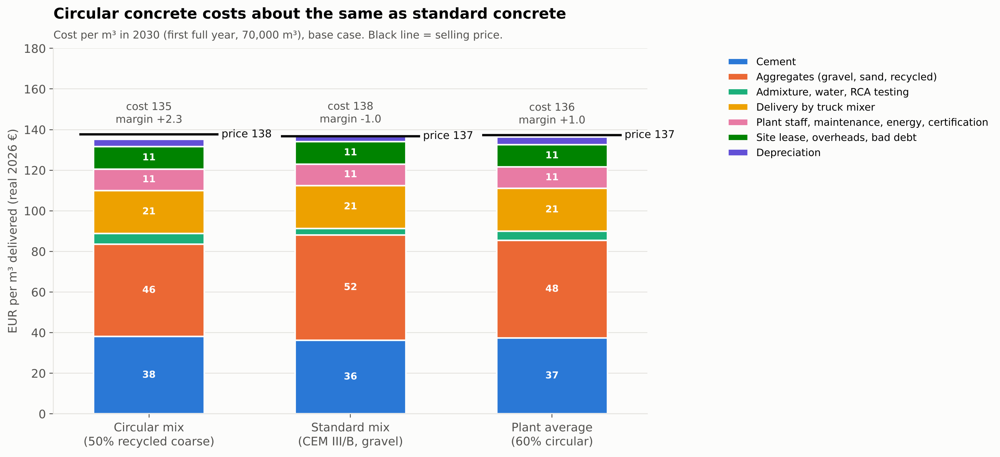
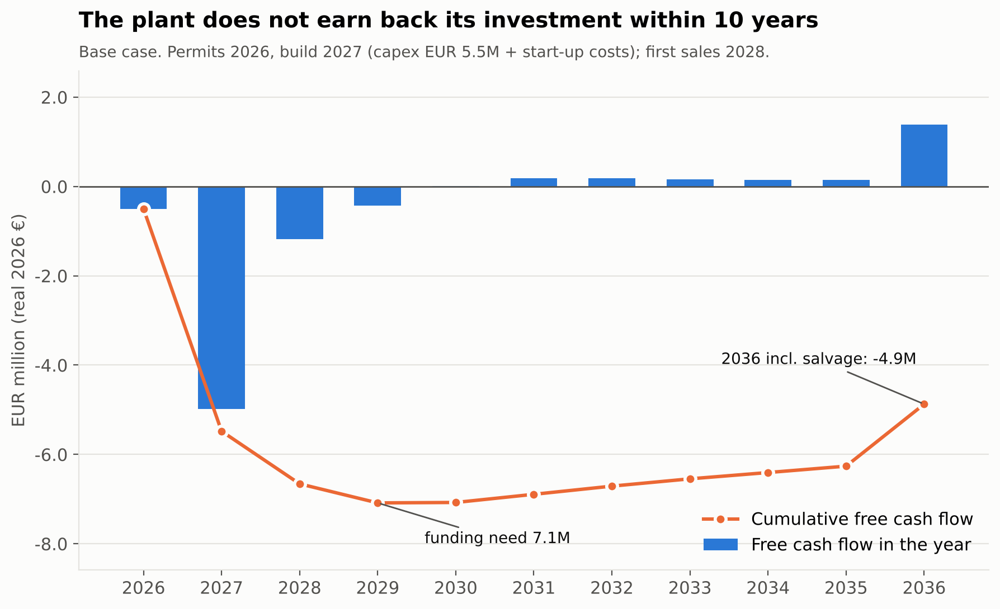
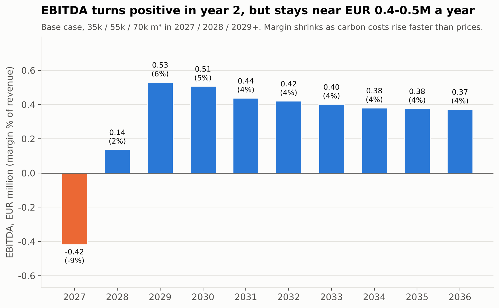
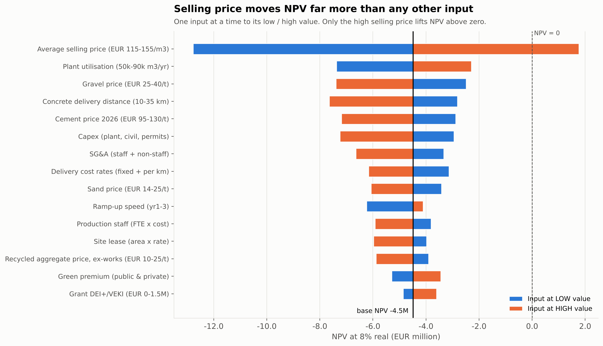
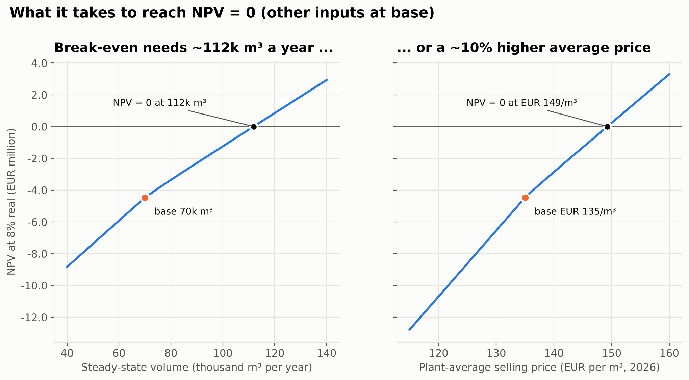
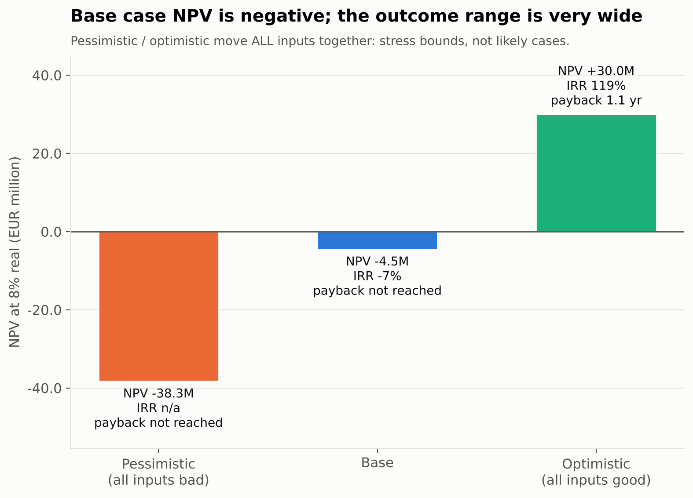

# Circular Concrete in the Netherlands — Business Plan and Viability Assessment

**Base case:** a circular ready-mix concrete plant (recycled aggregate + low-clinker cement), Zuid-Holland
**Prepared for:** investors and competition jury
**Date:** 22 October 2026
**Money:** real 2026 euros, excluding VAT. Discount rate 8% real. Horizon 2026–2036.

**How to read the labels.** **[VERIFIED]** = we found and read a source. **[ESTIMATE]** = we calculated it from sources or from the financial model. **[ASSUMPTION]** = no source; we explain our reasoning. Codes such as POL-17 or A-MKT-16 point to the source list (Appendix B) and the assumptions register (Appendix A). All model results are estimates from `model/financial_model.xlsx` and `model/model_core.py` (the two give the same numbers).

<!-- pagebreak -->

## Contents

1. Executive summary
2. Problem and opportunity
3. Policy and market context
4. Product, technology and operations
5. Competition
6. Price and cost breakdown
7. Financial plan and scenarios
8. Viability verdict and options
9. Selling points and go-to-market
10. Risks and mitigation
11. Conclusion and next steps

Appendix A — Key assumptions

Appendix B — Key sources

Appendix C — Method and red-team review

### Words used in this report

| Term | Meaning |
|---|---|
| **RCA** | Recycled concrete aggregate (Dutch: *betongranulaat*). Crushed old concrete that replaces gravel in new concrete. |
| **CEM III/B** | Blast-furnace slag cement. It contains only 20–34% clinker, so it has much lower CO₂ than ordinary cement (CEM I). It is the standard cement in Dutch ready-mix concrete. |
| **MKI** | *Milieukostenindicator*: the environmental cost of a product, in euros of "shadow cost" per m³. Dutch public clients use it in tenders. |
| **MPG** | *Milieuprestatie Gebouwen*: the legal limit for the environmental impact of a new building, in € shadow cost per m² floor area per year. |
| **Gate fee** | The price a demolition firm pays to a crusher (or to us) to accept its concrete rubble. |
| **EBITDA** | Earnings before interest, tax, depreciation and amortisation: the cash profit from operations. |
| **NPV** | Net present value: all future cash flows, discounted at 8% a year, minus the investment. NPV > 0 means the project earns more than 8%. |
| **IRR** | Internal rate of return: the discount rate at which NPV = 0. |
| **Payback** | The number of years until the cumulative cash flow turns positive. |
| **GWW / B&U** | GWW = civil works (roads, bridges, water). B&U = buildings (housing and utility). |

<!-- pagebreak -->

## 1. Executive summary

> **Verdict: NOT VIABLE.** A new stand-alone circular ready-mix plant in the Netherlands does not earn back its investment. Base-case NPV is **−€5.33M** at 8% (−97% of the €5.5M capex). IRR is **−13.9%**. Payback is not reached in 10 years. The verdict uses four criteria that were fixed before the model was built.

**The idea.** One ready-mix plant (70,000 m³/yr) on a waterside site in the Rotterdam–Drechtsteden area. It buys certified recycled aggregate (RCA) and uses CEM III/B cement. 60% of its volume is circular concrete with 50% recycled coarse aggregate. Permits in 2026, build in 2027, first sales in 2028.

**Why it fails.**

- **The product is fine; the plant is not.** The circular mix is about **€2.5/m³ cheaper** to make than the standard Dutch mix, because RCA costs less than gravel. But the whole plant earns only **€4.6/m³ EBITDA** (3.4% margin in 2030). It needs about **€11.7/m³** to repay €5.5M of capex at 8%. EBITDA stays at **€0.2–0.3M a year** from 2030 [ESTIMATE].
- **"Green" brings little cash.** Our circular mix has about the same CO₂ as the Dutch standard (132 vs 129 kg/m³), because the standard already uses low-CO₂ cement. Cash premiums are small and uncertain (base 1.5% on public work) [ESTIMATE; VERIFIED, MKT-20, MKT-25].
- **The market is tough.** Ready-mix volume fell 20% in 2023 (6.0 Mm³ at 178 plants). Large groups own cement and plants. A funded specialist (SL Materials, €100M commitment, Oct 2026) is expanding [VERIFIED, CMP-05, CMP-43].
- **Selling price dominates.** NPV = 0 needs a plant-average price of **€154/m³ (+14%)** or **134,000 m³/yr** (about 4× an average Dutch plant). Our €135/m³ base price is more likely too high than too low.

**The best route and what it would take.** We tested 10 options and 2 packages. **All have a negative NPV** (−€2.5M to −€6.3M). The route that comes closest is to **buy an existing plant, crush rubble on site with a demolition partner and sell 90,000 m³/yr under framework contracts** (package P2). Its NPV is **−€4.0M** (range **−€6.8M to −€1.4M**). It would need a gate fee of about **€15–30 per tonne** of rubble. Today's bulk market pays **€0–1/t** [VERIFIED, MKT-20].

**Recommendation.** **Do not invest** on present evidence. If the founders still want to pursue the idea, spend only **€50–100k on a due-diligence phase** (Q4 2026 – Q2 2027) to test three hard gates: a plant at ≤€2.5M, a rubble contract with a much higher gate fee, and ≥40,000 m³/yr of signed framework volume. If any gate fails, stop.

**Funding need of the base case:** €7.09M (lowest cumulative cash point, 2029). **EBITDA in the 3rd operating year (2030):** +€0.32M.

<!-- pagebreak -->

## 2. Problem and opportunity

### 2.1 The problem

Concrete is the most used building material in the Netherlands. The country uses about **14 Mm³ of concrete a year** (about 33 Mt; all types). Ready-mix concrete alone was **6.0 Mm³ in 2023** [VERIFIED, MKT-01, CMP-43]. Two problems sit in this chain:

- **CO₂.** Cement causes most of the CO₂ in concrete. The Betonakkoord (the national Concrete Agreement of 2018) now aims for at least **−70% CO₂ in 2030 vs 1990** [VERIFIED, POL-04, POL-05].
- **Waste and raw materials.** The country releases **11.5–15 Mt of concrete rubble a year**. Only **8–15% goes back into new concrete**. Most of it is crushed for road foundations [VERIFIED, MKT-05, MKT-09, POL-55]. At the same time about **75% of coarse aggregate (gravel, crushed rock) is imported**, and the last large Dutch river-gravel project ends in late 2026 [VERIFIED, MKT-17, MKT-18].

### 2.2 The opportunity we tested

Policy is pushing rubble back into concrete:

- The Betonakkoord caps the share of concrete in road-base granulate at **30% (2025), 15% (2027) and 5% (2030)** [VERIFIED, MKT-11].
- Its path for rubble back into concrete is **<15% (2025) → 20% (2026) → 30% (2027) → 40% (2028) → 50% (2029) → >60% (2030)** [VERIFIED, POL-01]. These targets are ambitions; they are not yet enforced [VERIFIED, POL-02].
- A draft decree makes **maximum MKI values for concrete compulsory in all public civil-works (GWW) tenders**, intended from 2027 (our base: 1 January 2028) [VERIFIED, POL-17; ASSUMPTION, A-POL-13].

So the question was: **can a new circular concrete business be financially viable in 2027–2036, and if not, what would have to change?**

### 2.3 Four business types we screened

| Type | What it does | Role in this plan |
|---|---|---|
| A. Recycling hub | Crushes and separates demolition concrete into recycled gravel, sand and cement-rich fines | Option (own crushing) |
| **B. Circular ready-mix / prefab producer** | Makes concrete with RCA and low-clinker cement | **Base case, modelled in depth (B1: ready-mix)** |
| C. Element reuse | Takes out, tests and resells whole concrete elements | Screened only; no public prices or volumes |
| D. Platform | Matches supply and demand; material passports | Option (asset-light licence) |

We chose **ready-mix (B1) over prefab (B2)**. A ready-mix plant costs about **€5.5M** for 70,000 m³/yr. A prefab plant costs about **€25M** for 30,000 m³/yr and needs ~75 staff [ESTIMATE, A-TEC-21, A-TEC-34]. Ready-mix also suits slow-hardening CEM III/B cement better, and a newcomer can reach revenue faster (12–18 months).

<!-- pagebreak -->

## 3. Policy and market context

### 3.1 Policy: what helps and what does not

- **Strongest demand driver: public civil works (GWW).** The draft GWW decree makes MKI ceilings compulsory for concrete in every public GWW tender. Above the EU threshold, the MKI of the whole work becomes an award criterion. Levels are not yet set [VERIFIED, POL-17, POL-18]. Municipalities are 30% of GWW turnover; about half of the GWW market rarely uses MKI today [VERIFIED, POL-20].
- **Tender rewards are real but go to the contractor.** Rijkswaterstaat adds about **€2 per € of MKI** to a bid; ProRail gives up to **±25% award advantage** [VERIFIED, POL-23, POL-24]. The concrete supplier only gains if the contractor shares the advantage.
- **Buildings (MPG) give little pull.** The planned tightening for homes (0.8 → 0.5) was **cancelled in June 2025**. From 1 July 2026 a new method applies (homes 1.6, the same strictness; offices 1.55, about 15% stricter) [VERIFIED, POL-08, POL-10].
- **Carbon cost (EU ETS and CBAM).** Free CO₂ allowances for cement fall from 97.5% (2026) to 0% (2034) under current law [VERIFIED, POL-39]. This raises the cost of high-clinker cement (CEM I) much more than CEM III/B. A July 2026 proposal would slow the phase-out to 2038 [VERIFIED, POL-42].
- **Waste policy does not force concrete-to-concrete.** The new Circulair Materialenplan (from 30 Dec 2025) counts road base as recycling. There is no levy on primary sand and gravel [VERIFIED, POL-54, POL-55].
- **Norms allow recycled aggregate, with limits.** NEN 8005 allows **30%** of coarse aggregate (most exposure classes) or **50%** (dry, unreinforced X0). CUR-Aanbeveling 112 allows up to 50% without changing design rules [VERIFIED, POL-30].
- **Subsidies help a little.** MIA/Vamil (net ~7–12% of eligible capex), WBSO (R&D wage credit), DEI+ and VEKI grants are competitive [VERIFIED, POL-68–POL-76].

### 3.2 Policy timeline 2026–2035

Effect: **+** helps this business, **−** hurts, **0** neutral.

| When | Event | Effect | Certainty |
|---|---|---|---|
| 2026 | Betonakkoord ceiling and front-runner values apply in signatory tenders; 21 developers sign intent declaration (June) | + (small premium segment) | High (values) / Medium (uptake) |
| 1 Jan 2026 | CBAM definitive phase; free allocation for cement −2.5% | + (small) | High |
| 1 Jul 2026 | New MPG method; homes not tightened; offices −15% | + (small) | High |
| 2026 | Circulair Materialenplan: road base counts as recycling | 0 / − | High |
| 18 Nov 2026 (planned) | EU Circular Economy Act proposal (end-of-waste rules) | + (later) | Medium / Low |
| 2027 | EU ETS review negotiations (proposal: phase-out to 2038) | − if adopted | Medium |
| 2027–2028 (base 1 Jan 2028) | **GWW decree: maximum MKI for concrete in all public GWW tenders** | **++** (main demand driver) | Medium–High |
| 2028 | Landfill tax €64/t (proposal); CBAM factor 90% | 0 / + | Medium / High |
| 1 Jan 2028 | EPBD: life-cycle CO₂ on the energy label for new buildings >1,000 m² | + (visibility) | High (EU) / Medium (NL) |
| 2028–2030 | Betonakkoord path: 40% → 50% → >60% of rubble back into concrete | + if enforced | Low |
| ~2029–2031 | Compulsory CO₂ declarations for precast concrete and aggregates (EU CPR) | + | Low–Medium |
| 2030 | CBAM factor 51.5%; CEM I carbon cost ~€45/t; landfill tax €81/t (proposal) | + | High (law) / Medium (price) |
| 2030 | Possible Dutch CO₂ limits for buildings; MPG evaluation | + (possible) | Low |
| ~2030 | Tata Steel blast furnace replaced → less slag for CEM III cement | − (cement cost) | Low |
| 2031–2033 | CBAM factor 39% → 26.5% → 14% | + | High (law) / Medium |
| 2034 | Free allocation for cement ends (current law); CEM I carbon cost ~€95/t | ++ for low-clinker vs CEM I | Medium (may move to 2038) |
| 2035 | EUA carbon price ~€125–140/t (forecasts) | + | Low |

Sources: policy.md §10 (POL-01, POL-14, POL-17, POL-39, POL-42, POL-51, POL-55, POL-82, POL-93).

**What this means.** Policy creates a real public-works market for low-MKI concrete from about 2028. But the CO₂ part of MKI is decided by the cement, not by recycled aggregate. Incumbents that already use CEM III/B meet the same ceilings. The policy push does not give a newcomer a price advantage by itself.

### 3.3 Market size and trends

- **Ready-mix:** 7.5 Mm³ (2022) → **6.0 Mm³ (2023)**, at **178 plants**, average **33,700 m³ per plant** [VERIFIED, CMP-43]. Prefab and concrete products ~5.3 Mm³ [VERIFIED, MKT-01].
- **Construction output** grows ~2.5–4.5%/yr in 2026–2027, then ~3%/yr [VERIFIED, MKT-32]. Demand for gravel is expected to fall after 2030 [VERIFIED, MKT-15]. We assume concrete volume is flat to −0.5%/yr after 2030 [ASSUMPTION, A-MKT-34].
- **Public renewal of bridges and locks** rises from €2.4bn/yr (2021–30) to €2.9bn/yr (2031–40) [VERIFIED, MKT-40].
- **Public and semi-public buyers** take about **40%** of concrete (range 30–50%) [ESTIMATE, A-MKT-24].
- **Prices.** Project prices for ready-mix are about **€110–165/m³** delivered (C20/25 to C30/37) [VERIFIED as published indication, MKT-27, secondary]. A primary Belgian retail list gives C20/25 €130 and C30/37 €139.5–144.5 delivered ≤20 km [VERIFIED, MKT-20]. Our base plant average is **€135/m³** [ASSUMPTION, A-MKT-16, confidence low].
- **Willingness to pay.** Incumbents *ask* +€3.30 to +€11/m³ for recycled content [VERIFIED, MKT-25]. But one primary price list sells recycled-aggregate concrete about **€20/m³ cheaper** than virgin concrete [VERIFIED, MKT-20]. PBL reports that much of the sector "still buys on lowest price" [VERIFIED, MKT-47]. Base: **1.5% cash premium on public circular volume, 0% private** [ASSUMPTION, A-FIX-03].

### 3.4 TAM, SAM and SOM

TAM = total market; SAM = the part that is open to a circular product; SOM = what one plant can realistically win.

| Level | Definition | Volume | Value per year |
|---|---|---|---|
| **TAM** | All Dutch ready-mix + prefab concrete | ~11.3 Mm³ | **≈ €2.5bn** (range €1.9–3.5bn) |
| **SAM, ready-mix** | Public/semi-public + sustainability-driven private buyers, technically suitable (85%) | ~2.6 Mm³ | **≈ €0.35bn** |
| **SAM, prefab** | Structural elements, public paving, sewer | – | ≈ €0.8bn |
| **Regional SAM** | Zuid-Holland ready-mix SAM inside one plant's delivery radius | ~0.36 Mm³ | ≈ €49M |
| **SOM (one plant)** | Mature output, base (low / high: 30k / 100k m³) | **60k m³/yr** | **≈ €8.2M** |

[ESTIMATE, market.md §8; A-MKT-30–32]. The financial model uses **70k m³/yr**, slightly above the SOM base. 70k is about **2× an average Dutch plant**. At 60k m³/yr the base NPV would be −€6.4M [ESTIMATE].

### 3.5 Region for the first plant

| Criterion (weight) | Zuid-Holland | Amsterdam region (MRA) | Noord-Brabant |
|---|---|---|---|
| Demand density (30%) | 5 | 5 | 4 |
| Rubble access (20%) | 5 | 4 | 3 |
| Circular pull / public MKI work (20%) | 4 | 5 | 3 |
| Water transport (15%) | 5 | 4 | 4 |
| Competition (15%; 5 = little) | 2 | 2 | 3 |
| **Weighted score** | **4.35** | **4.20** | **3.45** |

[ESTIMATE; weights are an ASSUMPTION; market.md §9]. **Zuid-Holland (Rotterdam–Drechtsteden)** ranks first: the largest housing pipeline (25% of all planned "woondeal" homes, 84% apartments), the biggest cluster of bridge renewals, ~2.7 Mt/yr of rubble and the best waterways for imported gravel [VERIFIED, MKT-39; ESTIMATE rubble]. Utrecht and Gelderland were excluded because of severe grid congestion [VERIFIED, MKT-38].

<!-- pagebreak -->

## 4. Product, technology and operations

### 4.1 Process flow (B1 ready-mix plant, RCA bought)

| Step | What happens | Key control |
|---|---|---|
| 1. Sourcing | Framework contracts with 2–4 certified crushers within 30–50 km (truck or barge) | Supplier must hold BRL 2506-1 (KOMO) for RCA |
| 2. Intake | Weigh, inspect, lot certificate; own samples per lot | Density and water absorption (EN 1097-6), constituents (EN 933-11), sulphate/chloride (EN 1744-1) |
| 3. Storage | Separate covered bins per fraction and source; sprinklers keep RCA wet | Stable water demand |
| 4. Batching | Moisture probes correct water automatically; weigh RCA, gravel, sand, cement, water, admixtures | Recipe per strength and exposure class |
| 5. Mixing | Twin-shaft mixer, 2–3 m³ per batch (~120 m³/h) | Consistency check |
| 6. Loading and delivery | Truck mixer, 8–10 m³ per load; placed within 1.5–2 hours | Delivery radius ~25–50 km |
| 7. Quality and certificates | Factory control to NEN-EN 206 + NEN 8005; KOMO certificate BRL 1801; product-specific LCA in the national database (NMD) | Needed to compete in MKI tenders |

[VERIFIED, TEC-01, TEC-45, TEC-58; technology.md §1]. The main technical risk is **slump loss** (the concrete stiffens) in the truck, because RCA absorbs more water than gravel. Covered bins, moisture probes and per-lot tests manage this.

### 4.2 Mix design (C30/37, per m³)

| kg/m³ | Circular mix (base) | Standard mix (CEM III/B) | CEM I mix (reference) |
|---|---|---|---|
| Cement | 345 CEM III/B | 330 CEM III/B | 320 CEM I |
| Gravel | 620 | 1,241 | 1,241 |
| Recycled coarse aggregate (RCA) | 560 (50% of coarse, by volume) | 0 | 0 |
| Sand | 630 | 639 | 639 |
| Water (effective + extra absorption water) | 165 + 28 | 165 | 165 |
| Superplasticiser | 3.1 kg | 2.3 kg | 2.2 kg |
| Recycled content in total aggregate | **31%** | 0% | 0% |

[ESTIMATE, A-CST-09; standard and CEM I mixes VERIFIED, NMD, TEC-04]. The circular mix needs **+15 kg cement** to make up for a ~9.5% strength loss at 50% RCA [ESTIMATE, A-TEC-11]. 50% RCA is allowed in X0 and, with CUR 112 acceptance, in other classes. For reinforced outdoor work without that acceptance, the fallback is 30% [VERIFIED, POL-30]. The financial model uses plant averages over all strength classes: 325 kg cement (circular) and 310 kg (standard) [ASSUMPTION, A-CST-11].

### 4.3 CO₂ and MKI per m³

| Product (C30/37) | CO₂, kg/m³ (modules A1–A3) | MKI, €/m³ (Betonakkoord basis) | Meets 2026 "outside" ceiling (169 kg / €10.9)? | Meets front-runner value (119 kg / €8.0)? |
|---|---|---|---|---|
| **Circular mix** | **132** (111–157) | **8.5** | yes | no |
| Standard CEM III/B | 129 (109–154) | 8.6 | yes | no |
| CEM I mix | 286 (244–323) | 17.7 | no (far above) | no |
| Option: circular + 55 kg activated cement paste | ~116 | ~7.6 | yes | yes |

[ESTIMATE, price_breakdown.md §12; ceilings VERIFIED, POL-01]. **Key point:** recycled aggregate gives circularity, not CO₂. In national database (NMD) data, 30% RCA lowers MKI by only **€0.49/m³ (−2%)**. Switching from CEM I to CEM III/B lowers it by **25%** [VERIFIED, TEC-04]. Because Dutch ready-mix already uses CEM III/B (~85% of products at the market leader), our circular mix is **not** lower-CO₂ than the Dutch standard [VERIFIED, CMP-27].

### 4.4 The plant

| Item | Base | Range | Label |
|---|---|---|---|
| Capacity | 120 m³/h (one shift ≈ 240,000 m³/yr theoretical) | – | ESTIMATE, A-TEC-23 |
| Output at steady state | 70,000 m³/yr (2030+), ramp 35k / 55.3k in 2028 / 2029 | 50–90k | ASSUMPTION, A-TEC-24 |
| Capex: plant equipment / civil / permits & engineering | €4.0M / €1.0M / €0.5M = **€5.5M** | €4.0–8.0M | ASSUMPTION, A-CST-02 |
| One-off costs in build year | LCA/EPD €80k; pre-opening €300k | – | ASSUMPTION, A-CST-03/04 |
| Site | 1.5 ha, waterside, leased at €10/m²/yr | 1–2.5 ha | ESTIMATE, A-TEC-22, A-CST-24 |
| Staff | 7 production + 3 sales/admin FTE | – | ASSUMPTION, A-CST-20 |
| Delivery | ~8 truck mixers, subcontracted | – | ESTIMATE, A-TEC-30 |
| Timing | Permits 2026 (12 months, range 6–24), build 2027, first sales 2028 | – | ASSUMPTION, A-POL-19, A-FIX-01 |

No public capex for a Dutch ready-mix plant was found; capex is an estimate from foreign and vendor anchors [ASSUMPTION, A-TEC-21]. Proven technology (TRL 9) is used throughout. Advanced recycling (recycled sand and cement paste, e.g. Smart Liberator, everox) is TRL 6–8 and is not needed for the base case.

<!-- pagebreak -->

## 5. Competition

### 5.1 Who competes

- **Integrated groups.** **Heidelberg Materials** (ex-Mebin, ~30 ready-mix plants, owns ENCI cement) sells EcoCrete/evoBuild with 30–100% RCA. **Holcim** sells ECOPact at only **+€5 to +€9/m³** over standard. **Dyckerhoff Basal** (Buzzi) has a national network [VERIFIED, CMP-28, CMP-35, CMP-36].
- **Family groups and recyclers.** De Hoop, Van Nieuwpoort, Rouwmaat (geopolymer), Theo Pouw (all concrete ≥30% RCA) [VERIFIED, CMP-39–CMP-42, CMP-69].
- **Deep-tech circular specialists.** **SL Materials** (ex-Urban Mine/Rutte, Zaandam) recovers sand, gravel and cement and got a **€100M commitment** in October 2026 [VERIFIED, CMP-04, CMP-05]. **everox** (ex-C2CA) is building a 100 kt/yr plant in 's-Gravendeel with Dura Vermeer — **in our target region** [VERIFIED, CMP-16, CMP-17].
- **Consolidation.** CRH/Cementbouw left ready-mix (2022–23); Heidelberg took over Kalle en Bakker's Maastricht customers (May 2026) [VERIFIED, CMP-33, CMP-38].

### 5.2 Positioning

| Scale / price ↓ — Circularity → | Low | Medium (30–100% coarse RCA and/or low-CO₂ binder) | High (recycled sand + recovered cement) |
|---|---|---|---|
| **High** (national network, own cement) | Dyckerhoff Basal; De Hoop; Van Nieuwpoort (standard) | Heidelberg (EcoCrete); VBI; Dycore | (empty today — target of SL Materials) |
| **Medium** (1–5 plants) | Local independent plants | Theo Pouw; Holcim Landgraaf; **our base plant would sit here** | SL Materials; Rouwmaat; Renewi (supplier) |
| **Low** (pilot, licensor) | – | Twee "R" | everox; Circulair Mineraal; SQAPE; Ecocem ACT |

[ASSUMPTION on placement, A-CMP-13; facts VERIFIED, competitors.md §8]. Our base product (50% coarse RCA + CEM III/B) is **"medium circularity at medium scale"**: head-to-head with Heidelberg and Theo Pouw, at lower scale. That is a weak spot.

### 5.3 Five Forces (1 = weak force, good for us; 5 = strong force, bad for us)

| Force | Rating | Why |
|---|---|---|
| Rivalry | **4** | 178 plants for 6.0 Mm³; volume −20% in 2023; incumbents already sell green lines at small surcharges; a €100M-funded specialist |
| Threat of new entrants | 3 | Entry is happening (SL Materials, everox, Circulair Mineraal); licensors lower the bar for everyone |
| Supplier power | **4** | Cement is concentrated (ENCI/Heidelberg had 50–60% in the last public figure); some suppliers are also rivals; clean rubble is held by demolition firms |
| Buyer power | **4** | Large contractors buy in bulk; some own their supplier; switching cost is low |
| Substitutes | 3 | Incumbents' low-CO₂ conventional concrete; timber/hybrid; element reuse |

[VERIFIED facts, ESTIMATE ratings; competitors.md §9]. **Attractiveness for a stand-alone new ready-mix entrant: low to medium.**

<!-- pagebreak -->

## 6. Price and cost breakdown

Values per m³ delivered in **2030**, the first full-output year (70,000 m³), base case. "Plant average" = all strength classes, 60% circular and 40% standard volume.

| € per m³ (2030) | Circular mix | Standard mix (CEM III/B) | Difference | Plant average |
|---|---|---|---|---|
| **Selling price** (incl. premium and carbon pass-through) | **137.6** | **136.7** | +0.8 | **137.2** |
| Cement (CEM III/B, incl. carbon cost) | 38.0 | 36.3 | +1.8 | 37.3 |
| Gravel | 19.8 | 39.7 | −19.9 | 27.8 |
| Recycled coarse aggregate (RCA), delivered | 13.7 | 0.0 | +13.7 | 8.2 |
| Sand | 12.0 | 12.1 | −0.2 | 12.0 |
| Admixture and water | 4.3 | 3.2 | +1.1 | 3.9 |
| RCA lot testing and handling | 1.0 | 0.0 | +1.0 | 0.6 |
| Delivery by truck mixer (20 km, 9 m³ load) | 21.1 | 21.1 | 0.0 | 21.1 |
| Production staff | 7.1 | 7.1 | 0.0 | 7.1 |
| Maintenance, certification, energy | 3.4 | 3.4 | 0.0 | 3.4 |
| Site lease | 2.1 | 2.1 | 0.0 | 2.1 |
| Overheads (SG&A) and bad debt | 8.9 | 8.9 | 0.0 | 8.9 |
| **Cash cost** | **131.6** | **134.1** | **−2.5** | **132.6** |
| **EBITDA** | **6.0** | **2.7** | +3.3 | **4.6** |
| Depreciation | 3.7 | 3.7 | 0.0 | 3.7 |
| **EBIT (profit before interest and tax)** | **2.3** | **−1.0** | +3.3 | **1.0** |

[ESTIMATE, model 2030 UnitEconomics; inputs in Appendix A]. Lines may not add exactly because of rounding.

**How to read this.**

- **Where the circular advantage comes from:** RCA delivered at **€24.5/t** replaces gravel at **€32/t**. That saves about €6/m³. Extra cement, admixture and testing cost about €3.8/m³. Net: **−€2.5/m³** [ESTIMATE]. Above about **€29/t** delivered RCA, the circular mix becomes more expensive than the standard mix [ESTIMATE].
- **The premium is small:** 1.5% on public circular volume gives only **€0.8/m³** on average [ESTIMATE, A-FIX-03].
- **Delivery is the second-largest cost** after materials: **€21.1/m³** = (€9 + €0.5 × 20 km) × 10/9 for an average 9 m³ load [ESTIMATE, A-TEC-28, A-FIX-02]. A waterside site saves about €9–14/m³ on gravel and sand against a truck-fed site — more than any green premium [ESTIMATE].
- **The gap:** the plant earns **€4.6/m³ EBITDA**. To repay €5.5M of capex at 8% over 10 years it needs about **€11.7/m³**. The gap is about **€7/m³ (5% of price)** [ESTIMATE].
- **Carbon cost:** CEM III/B carbon cost rises from ~€4/t (2026) to €12/t (2030) and €26/t (2034); CEM I from €14 to €45 and €95/t. This hurts CEM I users, not Dutch CEM III/B competitors [ESTIMATE, A-POL-07/08].

<!-- pagebreak -->

## 7. Financial plan and scenarios

### 7.1 Key results (base case)

| KPI | Base case | Note |
|---|---|---|
| NPV at 8% real (2026–2036, salvage-only terminal value) | **−€5.33M** | −97% of capex |
| IRR (real) | **−13.9%** | |
| Payback (simple / discounted) | **not reached in 10 years** | measured from 2026 |
| EBITDA in 3rd operating year (2030) | **+€0.32M** (3.4% margin) | 2029: −€0.02M |
| Funding need (lowest cumulative free cash flow) | **€7.09M** | in 2029 |
| Initial capex | €5.5M | + €0.38M start-up costs in 2027 |
| EBITDA = 0 at | 56,800 m³/yr | |
| NPV = 0 needs (one at a time) | 134,000 m³/yr, **or** €154.0/m³ (+14.1%), **or** a 58.5% public premium | none realistic |

[ESTIMATE, model `results.json`].

### 7.2 Base case per year (€M)

| Year | 2026 | 2027 | 2028 | 2029 | 2030 | 2031 | 2032 | 2033 | 2034 | 2035 | 2036 |
|---|---|---|---|---|---|---|---|---|---|---|---|
| Volume (k m³) | 0 | 0 | 35.0 | 55.3 | 70.0 | 70.0 | 70.0 | 70.0 | 70.0 | 70.0 | 70.0 |
| Revenue | 0.00 | 0.00 | 4.75 | 7.53 | 9.61 | 9.84 | 9.88 | 9.94 | 10.00 | 10.00 | 10.00 |
| EBITDA | 0.00 | −0.38 | −0.52 | −0.02 | 0.32 | 0.25 | 0.24 | 0.22 | 0.20 | 0.19 | 0.19 |
| EBIT | 0.00 | −0.38 | −0.77 | −0.27 | 0.07 | −0.00 | −0.02 | −0.04 | −0.07 | −0.07 | −0.08 |
| Free cash flow | −0.50 | −4.98 | −1.18 | −0.43 | 0.01 | 0.18 | 0.18 | 0.16 | 0.14 | 0.14 | 1.39 |
| Cumulative free cash flow | −0.50 | −5.48 | −6.66 | −7.09 | −7.08 | −6.89 | −6.71 | −6.55 | −6.41 | −6.26 | −4.87 |

[ESTIMATE, model]. 2036 free cash flow includes €1.25M salvage value (25% of plant and civil capex). Tax losses are carried forward; no tax is paid in the period.

**Why EBITDA falls after 2030.** Cement carbon and slag costs rise faster than the 80% we assume is passed on in concrete prices. Both pass-through rates (85% for cement, 80% for concrete) are **key judgement calls without a source** [ASSUMPTION, A-POL-09, A-CST-13]. With 100% concrete pass-through, NPV improves to −€4.93M. The verdict does not change.

**Funding.** We do not propose a funding mix, because the project does not earn its cost of capital. EBITDA of €0.2–0.3M a year cannot carry a meaningful bank loan [ESTIMATE].

### 7.3 Sensitivity: what moves NPV

| Driver (low / high input) | NPV at low | NPV at high | Swing |
|---|---|---|---|
| **Average selling price** (€115 / €155 per m³) | −€12.4M | **+€0.25M** | €12.6M |
| Concrete delivery distance (10 / 35 km) | −€3.5M | −€8.4M | €4.9M |
| Gravel price (€25 / €40 per t) | −€3.4M | −€7.8M | €4.5M |
| Plant utilisation (50k / 90k m³/yr) | −€7.5M | −€3.4M | €4.1M |
| Capex (€4.0M / €8.0M) | −€3.8M | −€7.9M | €4.1M |
| Cement price 2026 (€95 / €130 per t) | −€3.7M | −€7.7M | €4.0M |
| Truck-mixer load (8 / 10 m³) | −€6.3M | −€4.6M | €1.7M |
| RCA ex-works price (€10 / €25 per t) | −€4.7M | −€6.5M | €1.8M |
| Green premium (low / high) | −€5.9M | −€4.6M | €1.2M |
| ETS/CBAM carbon path only | −€5.2M | −€5.6M | €0.45M |
| Discount rate (6% / 10%) | −€5.3M | −€5.4M | €0.08M |

[ESTIMATE, model; 25 driver groups in the Sensitivity sheet]. **Only one single change lifts NPV above zero: a high selling price (€155/m³).** The two "circular" levers — green premium and RCA price — matter little.

**The price risk points down, not up.** Our €135/m³ rests on a secondary source. The primary GWL list gives C20/25 €130 and C30/37 €139.5–144.5 retail; contract prices are normally at or below retail. At €130/m³ NPV would be **−€7.1M** [ESTIMATE].

### 7.4 Scenarios — stress bounds and the realistic range

| KPI | Pessimistic (all inputs bad) | **Base** | Optimistic (all inputs good) |
|---|---|---|---|
| NPV | −€35.5M | **−€5.33M** | +€24.5M |
| IRR | n/a | **−13.9%** | 103.7% |
| Payback | not reached | **not reached** | 2.1 years |
| EBITDA 2030 | −€4.5M | **+€0.32M** | +€6.74M |
| Funding need | €52.0M | **€7.09M** | €2.84M |

**Important: the pessimistic and optimistic columns are stress bounds, not likely cases.** They move every input to its bad (or good) value at the same time. That will not happen in reality.

**Indicative realistic range: NPV −€15.3M to +€2.1M.** This is the base NPV plus/minus the combined effect of 22 drivers (root-sum-square). It treats related drivers as independent, so it is **not a probability interval** [ESTIMATE]. Most of the range is below zero.

**Conservative choices, disclosed.** Two rules from the plan make NPV lower than a going-concern view: the terminal value is salvage only (25% of capex), and working capital is not released at the end. Undoing both and assuming 100% price pass-through still gives **NPV −€3.42M** [ESTIMATE, model memo].

<!-- pagebreak -->

## 8. Viability verdict and options

### 8.1 Criteria fixed before the analysis

The four criteria below were fixed in the project plan **before** any model result. They were not changed after the results or after the review.

| # | Criterion | Base case value | Result |
|---|---|---|---|
| 1 | NPV > 0 at 8% real (salvage-only terminal value) | −€5.33M | **FAIL** |
| 2 | Payback < 7 years | not reached in 10 years | **FAIL** |
| 3 | EBITDA positive by the 3rd operating year (2030) | +€0.32M | **PASS** (narrowly) |
| 4 | NPV > 0 with at least 2 of 6 main drivers at their pessimistic value (one at a time) | 0 of 6 | **FAIL** |
| – | Borderline band: NPV between −10% and 0% of capex | −97% | no |

Criterion 4 detail (pessimistic value → NPV): green premium 0% → −€5.9M; RCA price €25/t → −€6.5M; transport distance (35 km delivery + 50 km RCA haul) → −€9.0M; cement €130/t + high carbon path → −€7.9M; utilisation 50k m³ → −€7.5M; capex €8.0M → −€7.9M [ESTIMATE].

> **Verdict: NOT VIABLE.** The original base before the review (first sales 2027) was also NOT VIABLE (NPV −€4.48M, shown only as a memo).

### 8.2 Options tested

| # | Option | NPV €M | IRR | EBITDA 2030 €M | Funding €M | Capex €M | Criteria passed |
|---|---|---|---|---|---|---|---|
| O0 | **Base: greenfield plant, first sales 2028** | **−5.33** | −13.9% | 0.32 | 7.09 | 5.50 | 1/4 |
| O1 | + own mobile crushing line | −6.24 | −12.3% | 0.49 | 9.05 | 7.50 | 1/4 |
| O2 | + crushing by a demolition partner on our site | −5.42 | −12.9% | 0.39 | 7.50 | 5.90 | 1/4 |
| O3 | **Buy and convert an existing plant** | **−3.54** | −14.4% | 0.33 | 4.93 | 3.70 | 1/4 |
| O4 | Framework / offtake contracts | −5.14 | −14.6% | 0.25 | 6.67 | 5.50 | 1/4 |
| O5 | Lower-CO₂ binder product (from 2029) | −5.86 | −16.4% | 0.25 | 7.41 | 5.65 | 1/4 |
| O6 | Asset-light licence + RCA service (no plant) | −2.51 | n/a | −0.28 (2029) | 3.35 | 0.20 | 0/4 |
| O7 | Maximum realistic subsidies | −4.77 | −13.0% | 0.32 | 6.49 | 5.50 | 1/4 |
| O8 | Bigger plant, 100k m³/yr | −4.15 | −7.3% | 0.70 | 7.10 | 5.50 | 1/4 |
| O9 | Urban site closer to demand (truck-fed) | −6.32 | −19.8% | 0.14 | 7.64 | 5.50 | 1/4 |
| P1 | O3 + partner crushing + frameworks | −3.97 | −15.7% | 0.32 | 5.42 | 4.10 | 1/4 |
| **P2** | **P1 + scale to 90k m³/yr (+€1.0M expansion)** | **−4.01** (range −6.77 to −1.42) | −10.6% | 0.59 | 6.37 | 5.10 | 1/4 |

[ESTIMATE, `results_options.json`]. Payback is not reached for any option. **No option passes criterion 4 (0 of 6 drivers). Every option is NOT VIABLE; none is borderline.** O6 has the least negative NPV only because it invests almost nothing; its EBITDA never turns positive.

### 8.3 The closest route, P2, as a range

P2 combines favourable inputs: an acquired plant, 90,000 m³/yr (2.7× an average Dutch plant), two framework contracts and a long rubble contract. It is a scenario of favourable inputs, not a likely case.

| Stack | Inputs changed vs P2 base | NPV | IRR | Payback | Funding |
|---|---|---|---|---|---|
| Downside | gate fee €0/t, steel 0.5%, washing €4/t, expansion €2.0M, public premium 0%, 8 m³ loads | **−€6.77M** | −25.9% | not reached | €7.91M |
| **Base** | – | **−€4.01M** | −10.6% | not reached | €6.37M |
| Upside | gate fee €5/t, steel 3% kept by us, washing €2/t, expansion €0.5M, public premium 3%, 10 m³ loads | **−€1.42M** | 1.9% | 9.9 years | €5.49M |

[ESTIMATE, model; A-FIX-12]. **Even the upside stack stays below zero.** P2 reaches NPV = 0 only with a gate fee of **€29.7/t** on its base terms (€15.2/t if every other input is at its upside; €45.3/t at the downside). The bulk market accepts clean concrete rubble at **€0–1/t** and charges extra for reinforced rubble [VERIFIED, MKT-20].

### 8.4 What the business depends on

| Condition | Base (O0) | P2 |
|---|---|---|
| Average concrete price for NPV = 0 (today €135/m³) | €154.0/m³ | €146.7/m³ |
| Steady volume for NPV = 0 | 134k m³/yr | 147k m³/yr |
| Public green premium for NPV = 0 (base 1.5%) | 58.5% | 37% |
| MKI value per circular m³ for NPV = 0 | €31.8 | €19.5 |
| Gate fee for NPV = 0 | n/a (no crushing) | €29.7/t |
| A levy on primary aggregates | does not help at any level | does not help |
| Faster ETS phase-out (high carbon path) | −€5.60M (hurts) | −€4.30M (hurts) |

[ESTIMATE, viability_options.md §6]. **None of the needed conditions is a "green" factor.** What would matter: (a) much higher gate fees for clean rubble; (b) low prices for existing plants; (c) a clearly higher selling price or volume. None of these is in sight on present evidence. A levy on primary aggregates does not help because our mixes still use 1.25–1.9 t of primary sand and gravel per m³.

<!-- pagebreak -->

## 9. Selling points and go-to-market

This section describes how the closest route (P2) would be sold. **It is a plan for what a due-diligence phase would test, not an investment plan.**

### 9.1 Honest core message

- Our circular mix is **cheaper to make** than the Dutch standard (−€2.5/m³) and has **31% recycled content** (621 kg gravel saved per m³).
- Its **CO₂ is about the same** as the Dutch CEM III/B standard. The big CO₂ gap exists only against CEM I, which is rare in Dutch ready-mix.
- So we would sell **"circular at the standard price, with documented recycled content"**, not "low-CO₂ at a premium". Incumbents charge +€3.30 to +€5.50/m³ for 30–50% recycled content [VERIFIED, MKT-25].

### 9.2 Selling points per segment

| Segment | Selling point | Honest limit |
|---|---|---|
| **Mid-size GWW contractors** (public maintenance and renewal work) | Product-specific EPD and MKI statement per project; meets MKI ceilings under the coming GWW decree; framework volume | Meets the ceiling, not the front-runner value. vs a CEM III/B rival the tender advantage is only €0.2–0.5/m³ |
| **Municipalities, province, water boards** | Must set MKI ceilings from ~2028; ready-made specs; 50% RCA allowed in unreinforced (X0) work | Help is paperwork and certainty, not a premium; they buy mostly on price |
| **Housing corporations** | Long building programmes → 3–5-year frameworks; recycled-content reporting for own targets | No real CO₂ gain vs standard; MPG gives no pull for homes before ~2030 |
| **Developers** (later) | Life-cycle CO₂ disclosure from 2028 | Cash premium ≈ 0%; not a first segment |
| **Demolition firms** (suppliers) | A 7–10-year outlet for 40.5 kt/yr of rubble as road-base use is capped; paid crushing work | They can take clean rubble elsewhere at ~€0/t; the gate fee P2 needs (~€30/t) is far above the market |
| **Owners of small ready-mix plants** (sellers) | An exit in a shrinking market; staff and name kept | No Dutch transaction prices found; €2.5M buys about a 35k m³ plant |

[market.md §6; value_proposition.md §1].

### 9.3 Honest weak points

| # | Weak point | Our answer | What remains |
|---|---|---|---|
| 1 | The economics do not work | Small diligence phase with hard gates | Even at target terms (plant €2.0M, gate fee €10/t) P2 NPV is −€2.24M |
| 2 | Buyers buy on price | Price parity on private work | Full parity costs P2 only −€0.19M; the premium is not the problem |
| 3 | Little CO₂ advantage vs CEM III/B | Do not claim low-CO₂; sell recycled content; add a lower-CO₂ binder when certified | The binder option loses money (O5: −€0.53M vs base) |
| 4 | Incumbents sell green lines at small surcharges | Parity price undercuts their surcharge by €3–5.50/m³ | They can drop the surcharge any day |
| 5 | SL Materials (€100M) and everox (in our region) | Stay on volume work; consider them as suppliers of binder or recycled sand | If SL Materials opens near Rotterdam, our claim looks ordinary |
| 6 | Quality perception and liability | Start with unreinforced/inside work; lot testing; publish test data | >30% RCA outdoors needs client acceptance per project |
| 7 | Slag supply for CEM III/B after ~2030 | Multi-year cement contract; binder trials; price indexation | Cement + ETS stress gives P2 −€7.30M |
| 8 | 90k m³ is a big plant | Sign frameworks before buying (gate C) | At 80k m³ P2 NPV is −€4.88M |

[value_proposition.md §2; model runs R-01 to R-20].

### 9.4 Business Model Canvas (P2 concept, year 2030)

| Block | Content |
|---|---|
| Customer segments | Mid-size GWW contractors; municipalities/province/water boards (as spec-setters); housing corporations. Supply side: demolition firms (they pay a gate fee) |
| Value propositions | Certified circular ready-mix at the standard CEM III/B price; EPD and MKI statement per project; reserved framework volume. For partners: rubble outlet + paid crushing; for a seller: a cash exit |
| Channels | Direct sales to contractors' buyers and concrete technologists; public framework tenders; Betonakkoord coalitions and circular deals |
| Customer relationships | Multi-year frameworks with a price formula; technical support in building teams; monthly MKI and recycled-content report |
| Revenue streams | Concrete ≈ €12.26M/yr (90k m³ × ~€136.2); gate fees €0.04M; steel scrap €0.03M; crusher sand €0.05M. Total ≈ **€12.38M** |
| Key resources | Permitted waterside plant with ≥1 ha extra space; KOMO/CSC certificates, BRL 2506; product EPDs; rubble and framework contracts; existing plant staff |
| Key activities | Buy, convert (€0.8M) and expand (+€1.0M) the plant; certified mix design and lot testing; campaign crushing by the partner; dispatch (average 22.7 km); binder trials |
| Key partners | Demolition firm; plant seller; cement supplier; truck-mixer hauliers; certification body and LCA consultant; bank and impact investors; province (permit) |
| Cost structure | Materials ≈ €85–90/m³; delivery ≈ €22.6/m³; staff, lease, maintenance, SG&A; crushing costs ≈ €0.6M/yr against an RCA credit of €0.58M. Capex **€5.1M**; funding need **€6.37M**; EBITDA 2030 **€0.59M (4.7%)** |

[ESTIMATE, value_proposition.md §3; model P2].

### 9.5 Pricing

- **Concrete:** parity on private work; at most ~3% (≈€4/m³) on public or MKI-scored circular work, always below incumbents' circular surcharge. Framework discount capped at about −€1/m³ on all volume. Each €1/m³ on the average price is worth about **€0.36M NPV** in P2 [ESTIMATE].
- **Contract clauses:** 100% binder-cost indexation; delivery zones (+€0.5/m³ per km beyond ~22–25 km); under-load surcharge below 9 m³.
- **Gate fee (supply side):** a hard gate. Each €1/t of gate fee is worth about €0.15M NPV in P2 [ESTIMATE]. Steel-scrap ownership must be agreed in writing.

### 9.6 Roadmap with go/no-go gates

| When | Step | Gate (pass test) | If it fails |
|---|---|---|---|
| Q4 2026 – Q1 2027 | **Due diligence (€50–100k):** screen waterside plants in Zuid-Holland; talk to 2–3 demolition firms and 3–4 anchor customers; get an expansion quote | **Gate A — plant:** signed letter of intent at **≤ €2.5M** (target ≤ €2.0M), ≥1 ha extra space, rubble intake possible under the permit, expansion to 90k m³ ≤ €1.0M | Price €3.0M → P2 NPV −€4.53M. **Stop.** |
| Q1 – Q2 2027 | Test rubble and crushing terms | **Gate B — rubble (hard gate):** 7–10-year contract with a gate fee and steel split that bring P2 to NPV ≥ 0 (≈ €30/t on base terms; ≈ €15/t only if all other inputs are at their upside); crushing ≤ €7.5/t | Today's bulk evidence is €0–1/t. **Stop.** |
| Q1 – Q2 2027 | Test demand | **Gate C — volume:** signed frameworks for **≥ 40k m³/yr** | 80k → −€4.88M. **Stop.** |
| Q2 2027 | Decision | Invest only if A + B + C are signed **and** the model, re-run with the signed terms, passes all plan criteria | **Do not invest.** Only the diligence budget is lost |
| H2 2027 (only if invested) | Buy, convert and expand the plant; certify circular mixes; file the crushing permit | Circular mixes certified; first framework deliveries signed for 2028 | Delay → re-check NPV |
| 2028 | First sales year (49.5k m³); GWW decree expected; start binder trials | **Gate D (end 2028):** ≥75k m³ run-rate; crushing permit granted | Keep buying RCA; no extra site spend |
| 2029–2030 | Crushing starts 2029; 90k m³ from 2030 | **Gate E (end 2030):** EBITDA ≥ €0.6M; decide on lower-CO₂ binder | Renegotiate gate fee or steel split |

[value_proposition.md §6]. **On present evidence gate B is expected to fail.** The asset-light licence (O6) is not a rescue: it also loses money (NPV −€2.51M). At most it is a capped pilot (≤ €0.5M over 2 years).

<!-- pagebreak -->

## 10. Risks and mitigation

Likelihood (L) and impact (I): H = high, M = medium, L = low. NPV effects are from the model, one input at a time, on the base case unless stated.

| # | Risk | L | I | Size (evidence) | Mitigation |
|---|---|---|---|---|---|
| R1 | Average selling price below €135/m³ | H | H | €130/m³ → NPV −€7.1M; €115 → −€12.4M | Verify real project prices with 2–3 contractor buyers before any commitment; price discipline; delivery zones |
| R2 | Volume below plan (70k = 2× average plant) | H | H | 50k m³ → −€7.5M; 60k → −€6.4M | Signed frameworks ≥ 40k m³/yr before buying (gate C); buy a plant with a customer book |
| R3 | Rubble terms: gate fee and steel split (integrated route) | H | H | P2 needs ≈ €30/t; market €0–1/t | Hard gate B; walk away if not signed |
| R4 | Delivery cost and distance (part loads, waiting time) | M | H | 35 km → −€8.4M; 8 m³ loads → −€6.3M | Waterside site close to demand; zone pricing; under-load surcharge |
| R5 | Cement price and slag scarcity after ~2030 | M | H | €130/t + high carbon path → −€7.9M | Multi-year cement contract; 100% binder indexation; binder trials (activated cement paste, CEM VI) |
| R6 | Incumbent reaction and funded specialists (Heidelberg, SL Materials, everox) | H | M | Rivalry 4/5; green surcharges can drop to zero | Do not compete on "most circular"; partner or buy recycled products from specialists |
| R7 | Capex overrun or older equipment in an acquired plant | M | M | Capex €8.0M → −€7.9M; plant €4.0M → P2 −€5.58M | Fixed-price quotes; technical due diligence; expansion quote before purchase |
| R8 | Permits, nitrogen and grid connection delay | M | M | Permit 6–24 months (ready-mix), 9–36 (crushing) | Buy a permitted plant; site far from Natura 2000; electric equipment |
| R9 | Quality and liability of RCA concrete (slump drift; client acceptance of >30% RCA) | M | M | Contractor RCA use fell in 2024 (VolkerWessels) | Lot testing; moisture probes; start with unreinforced/inside work; publish test data |
| R10 | Policy slips (GWW decree later, ceilings at "peloton" level; ETS phase-out to 2038) | M | L | ETS path swing only €0.45M | Do not build the case on policy premiums; treat them as upside |
| R11 | Construction downturn (ready-mix −20% in 2023) | M | M | Volume and price both fall | Public renewal work as anchor (€2.9bn/yr civil structures 2031–40) |
| R12 | Customers leave after a plant takeover | M | M | Slower ramp 50/79% → O3 −€3.69M | Earn-out for the seller; keep staff and brand |

[ESTIMATE, model; VERIFIED evidence as cited in sections 3–9].

**Risk map (likelihood × impact)**

| Likelihood ↓ / Impact → | Low | Medium | High |
|---|---|---|---|
| **High** | – | R6 | **R1, R2, R3** |
| **Medium** | R10 | R7, R8, R9, R11, R12 | R4, R5 |
| **Low** | – | – | – |

The top-right risks (R1–R3) are commercial, not technical. They are also the ones a small due-diligence phase can test cheaply.

<!-- pagebreak -->

## 11. Conclusion and next steps

### 11.1 Conclusion

1. **A stand-alone circular ready-mix plant in the Netherlands is NOT VIABLE** under criteria fixed in advance. NPV −€5.33M, IRR −13.9%, no payback in 10 years, 0 of 6 robustness tests passed.
2. **The circular product is not the problem.** It is €2.5/m³ cheaper to make than the Dutch standard. The problem is a thin ready-mix margin (€4.6/m³ EBITDA) that cannot carry €5.5M of new capex in a mature, consolidating market.
3. **"Green" adds little cash.** CO₂ is about the same as the Dutch CEM III/B standard; cash premiums are small and two-sided; tender rewards go mainly to contractors.
4. **No route is investable on present evidence.** The integrated acquisition route (P2) comes closest, but its range is −€6.8M to −€1.4M. Break-even would need a gate fee of ~€15–30/t against €0–1/t in the market.
5. **The verdict is robust.** Undoing all conservative modelling choices still gives −€3.4M. The likely error in the #1 driver (price) points to a worse result.

### 11.2 Recommendation

- **Do not invest** in a greenfield plant or in an acquisition on present evidence.
- **If the founders want to pursue the idea:** fund only a **€50–100k due-diligence phase** (Q4 2026 – Q2 2027) to test gates A–C. Stop if any gate fails.

### 11.3 What the due-diligence phase should find out

| Question | How | Why it matters |
|---|---|---|
| Real project prices by strength class | Interviews with 2–3 contractor buyers | #1 driver: €1/m³ ≈ €0.36M NPV (P2) |
| Bulk gate fees for clean rubble and steel ownership | Talks with 2 demolition firms | Gate fee €0 → €10/t = €1.4M NPV on P2; NPV = 0 needs ≈ €30/t |
| Prices of small Dutch ready-mix plants and expansion cost | 1–2 M&A advisers; equipment quotes | Purchase €1.5–4.0M = €2.6M NPV range on P2 |
| Delivered prices of gravel, sand, RCA, cement in Zuid-Holland | One plant buyer; supplier quotes | Gravel and cement each swing NPV by ~€4M |
| Truck-mixer subcontract rates and real loads | One haulier | Delivery is the second-largest cost |
| GWW-decree ceiling levels (2028) | Ministry / CROW publications | Decides when a lower-CO₂ binder is needed |

### 11.4 What would change the conclusion

The conclusion would change only if **several** of these turn out much better than today's evidence at the same time: a plant-average price well above €145/m³; a rubble contract paying €15–30/t; a plant at ≤ €2.0M with a large customer book; and signed volume close to 90,000 m³/yr. A single favourable finding is not enough.

<!-- pagebreak -->

## Appendix A — Key assumptions

The full register has **207 assumptions** with reasoning and confidence: `research/assumptions.md`. Machine-readable inputs: `model/inputs.csv`. Confidence: H = high, M = medium, L = low.

| ID | Assumption | Low | Base | High | Unit | Label / confidence |
|---|---|---|---|---|---|---|
| A-MKT-16 | Plant-average ready-mix price, delivered, all classes | 115 | **135** | 155 | €/m³ | ASSUMPTION / L |
| A-FIX-03 | Green premium, public circular volume (40% of sales) | 0 | **1.5** | 3 | % | ASSUMPTION / L |
| A-MKT-26 | Green premium, private volume | −2 | **0** | 3 | % | ASSUMPTION / L |
| A-TEC-24 | Steady-state output (from 2030) | 50 | **70** | 90 | k m³/yr | ASSUMPTION / L |
| A-TEC-44 | Share of volume sold as circular mix | 40 | **60** | 80 | % | ASSUMPTION / L |
| A-FIX-01 | First sales (permits 2026, build 2027) | 2027 | **2028** | 2029 | year | ASSUMPTION / M |
| A-CST-02 | Capex: equipment / civil / permits | 3.0 / 0.6 / 0.4 | **4.0 / 1.0 / 0.5** | 5.5 / 1.8 / 0.7 | €M | ASSUMPTION / L |
| A-CST-03/04 | LCA/EPD; pre-opening (expensed 2027) | 40; 200 | **80; 300** | 160; 500 | k€ | ASSUMPTION / L |
| A-CST-12 | CEM III/B price 2026, delivered | 95 | **110** | 130 | €/t | ESTIMATE / L |
| A-POL-09 | Carbon cost passed into cement price (key judgement call) | 50 | **85** | 100 | % | ASSUMPTION / L |
| A-CST-13 | Binder cost passed into concrete price (key judgement call) | 50 | **80** | 100 | % | ASSUMPTION / L |
| A-POL-01–03 | EUA carbon price 2027 / 2030 / 2034+ | 65 / 70 / 85 | **88 / 100 / 125** | 105 / 130 / 180 | €/t CO₂ | ESTIMATE / M–L |
| A-POL-28 | Slag cement price uplift from 2031 | 0 | **10** | 25 | % | ASSUMPTION / L |
| A-MKT-11 | Gravel, delivered by barge | 25 | **32** | 40 | €/t | ASSUMPTION / L |
| A-MKT-12 | Sand 0/4, delivered | 14 | **19** | 25 | €/t | ASSUMPTION / L |
| A-MKT-13 | RCA ex-works crusher (certified) | 10 | **15** | 25 | €/t | ASSUMPTION / L |
| A-TEC-32 | RCA haul: distance × rate + handling | 15 km × 0.18 + 1.5 | **30 km × 0.25 + 2** | 50 km × 0.35 + 3 | €/t | ESTIMATE / M |
| A-CST-09 | Circular C30/37 mix: coarse RCA share; extra cement | 30%; +0 kg | **50%; +15 kg** | 50% + 25% fine; +30 kg | – | ESTIMATE / M |
| A-CST-11 | Plant-average cement content (standard mix) | 290 | **310** | 330 | kg/m³ | VERIFIED basis (ERMCO) / M |
| A-TEC-28 | Delivery cost at a 10 m³ reference load | 7 + 0.4/km | **9 + 0.5/km** | 11 + 0.6/km | €/m³ | ESTIMATE / M |
| A-FIX-02 | Average truck-mixer load | 8 | **9** | 10 | m³ | ESTIMATE / M |
| A-CST-27 | Average one-way delivery distance | 10 | **20** | 35 | km | ESTIMATE / M |
| A-CST-20/21 | Staff: production 7 × €70k; SG&A 3 × €90k | 6 × 62k; 2 × 80k | **7 × 70k; 3 × 90k** | 9 × 78k; 4 × 110k | FTE × €/yr | ESTIMATE / M |
| A-CST-25 | Other overheads | 200 | **300** | 450 | k€/yr | ASSUMPTION / L |
| A-CST-24 | Waterside site lease (1.5 ha) | 6 | **10** | 15 | €/m²/yr | ESTIMATE / L |
| A-CST-22 | Maintenance and wear | 1.5 | **2.5** | 4.0 | % of capex/yr | ASSUMPTION / L |
| A-CST-06 | Salvage value in 2036 (terminal value) | 10 | **25** | 40 | % of capex | ASSUMPTION / L |
| A-CST-07 | Receivables / payables / inventory | 45 / 21 / 7 | **60 / 30 / 10** | 75 / 45 / 15 | days | ASSUMPTION / L |
| A-POL-24 | DEI+ / VEKI grant | 0 | **0.4** | 1.5 | €M | ASSUMPTION / L |
| A-POL-21/22 | MIA: net value; share of capex eligible | 7%; 0% | **9.3%; 20%** | 11.6%; 50% | % | ESTIMATE / M–L |
| A-FIX-04 | Gate fee received, clean rubble (options only) | 0 | **1** | 10 | €/t | ASSUMPTION / L |
| A-FIX-05/06 | Steel yield; share of steel value we keep (options) | 0.5%; 0% | **1%; 50%** | 3%; 100% | % | ASSUMPTION / L |
| A-OPT-06 | Purchase price of an existing plant (O3, P1, P2) | 1.5 | **2.5** | 4.0 | €M | ESTIMATE / L |
| A-FIX-10 | Expansion capex to 90k m³ (P2) | 0.5 | **1.0** | 2.0 | €M | ASSUMPTION / L |
| A-OPT-05 | Contract crushing rate (unverified anchor) | 5 | **7.5** | 10 | €/t | ASSUMPTION / L |
| – | Discount rate (real) | 6 | **8** | 10 | % | Client choice |
| – | Corporate tax (Vpb) | – | **19% to €200k; 25.8% above** | – | % | VERIFIED |

<!-- pagebreak -->

## Appendix B — Key sources

The full list has **380 sources** with URLs and access dates: `research/sources.md`. All were accessed on 22 October 2026. "Secondary" = trade press or a supplier blog.

| ID | Title | Publisher | Date | Used for |
|---|---|---|---|---|
| POL-01 | De koers naar 2030 | Betonakkoord (expert committee) | 2025-06 | MKI/CO₂ ceiling and front-runner values; rubble-to-concrete path |
| POL-08 | Milieuprestatie gebouwen (MPG) | RVO | 2026 | MPG limits from 1 July 2026 |
| POL-10 | Minister omarmt advies STOER | Rijksoverheid | 2025-06-23 | MPG tightening for homes cancelled |
| POL-17 | Consultatie Besluit milieuprestatie-eisen GWW | Internetconsultatie.nl | 2026-07 | Compulsory MKI ceilings in public GWW tenders |
| POL-20 | Toepassingsgebied dwingende MKI in de GWW | Rijksoverheid (Witteveen+Bos) | 2024-02 | GWW client shares; MKI reduction targets |
| POL-23 | DuboCalc webinar opdrachtgevers | Rijkswaterstaat / Platform WOW | 2020 | MKI valuation in tenders (€2 per € MKI) |
| POL-24 | MKI bij ProRail | ProRail | 2025-07 | ±25% award advantage |
| POL-30 | Betongranulaat in gestorte betonconstructies | Betonhuis | n.d. | NEN 8005 and CUR 112 replacement limits |
| POL-39 | CBAM definitive regime 2026 | DEHSt | 2026 | Free allocation phase-out 2026–2034 |
| POL-42 | EU ETS review proposal | ICAP | 2026-07 | Proposal to slow phase-out to 2038 |
| POL-51 | Kabinet schrapt deel verhoging afvalheffingen | AfvalOnline (secondary) | 2026-09 | Landfill tax path to €81/t |
| POL-55 | Beton (ketenplan) | Circulair Materialenplan (IenW) | 2025-11 | Minimum standard; >90% of rubble to road base |
| POL-68 | Milieulijst 2026 (MIA/Vamil) | RVO | 2026-03 | Tax incentive rates |
| MKT-05 | De koers naar 2030 | Betonakkoord | 2025-06 | <15% of ~15 Mt rubble back in concrete |
| MKT-09 | Hergebruik betonreststromen 2030–2050 | Betonhuis | 2021-06 | Rubble volumes 2018–2030 |
| MKT-11 | Circulariteitseisen Betonakkoord 2023 | Betonakkoord | 2023-09 | Cap on concrete in road-base granulate |
| MKT-15 | Landelijk beeld bouwgrondstoffen | Tweede Kamer (IenW/VRO) | 2026-06 | Gravel demand and outlook |
| MKT-17 | Surface mineral resources | TNO | 2025 | ~75% of coarse aggregate imported |
| MKT-20 | Prijslijst Betoncentrale en Breekwerf GWL | GWL Recycling (BE) | 2026-02 | Aggregate and rubble prices; €0/t gate fee; retail concrete prices; "recup" discount |
| MKT-25 | Prijslijst 2026 | Heidelberg Materials NL Beton | 2025-12 | List surcharges for recycled content; CEM III/B default |
| MKT-27 | Beton prijs per m³ (2026) | Dutch Fiber Trading (secondary) | 2026-07 | Indicative project prices |
| MKT-47 | Circulair beton — Rutte Groep | PBL | 2021-11 | "~10% more expensive"; sector buys on price |
| CMP-04 | Urban Mine wordt SL Materials | SL Materials | 2026-07 | Competitor profile |
| CMP-05 | €100 million commitment (press release) | SL Materials | 2026-10 | Competitor funding |
| CMP-17 | Everox first commercial-scale plant | Construction Briefing (secondary) | 2026-09 | everox plant, 100 kt/yr |
| CMP-27 | Mebin bouwt aan een beter milieu | Heidelberg Materials / Mebin | 2020-03 | CEM III/B in ~85% of products; CO₂ by cement type |
| CMP-35 | Prijslijst Betoncentrale Landgraaf 2026 | Holcim Cement Nederland | 2025-11 | ECOPact premium +€5–9/m³ |
| CMP-43 | Ready-Mixed Concrete Industry Statistics 2023 | ERMCO | 2024-09 | 6.0 Mm³, 178 plants, 33.7k m³/plant; truck sizes |
| TEC-01 | Betongranulaat in gestorte betonconstructies | Betonhuis | n.d. | Norm limits; CROW-CUR 127 |
| TEC-04 | Categorie 3 LCA rapport betonmortel (v6) | Stichting NMD | 2025-03 | Reference mixes; MKI per module |
| TEC-33 | Selective demolition and recycling of Dutch infrastructure concrete | Construction and Building Materials | 2026-05 | RCA quality data |
| CST-01 | Boundary conditions category 3 data | Stichting NMD | 2026 | ×1.3 markup on generic data |
| CST-06 | Samenvatting CAO Mortelbedrijven 2026 | salaris-informatie.nl (secondary) | 2026-07 | Wage levels |
| OPT-01 | Cementir 2024 results | Cementir Holding | 2025-03 | Plant deal (price not confirmed — unverified) |
| OPT-04 | On-site crushing price | SK Groundworks (UK) | n.d. | Contract crushing rate — **unverified** |
| FIX-S01 | 4K-Beton results (5.7% EBITDA margin) | Cemnet (via red team; not opened by us) | n.d. | Thin ready-mix margins |

<!-- pagebreak -->

## Appendix C — Method and red-team review

### C.1 Method

1. **Scope and criteria (Phase 0).** The client confirmed the base case (ready-mix/prefab), national scope, an 8% real discount rate and the four viability criteria **before** any research or modelling.
2. **Research (Phase 1).** Four parallel research streams: policy, market, technology, competitors. Every claim is labelled VERIFIED / ESTIMATE / ASSUMPTION and logged with an ID. Only public sources; no expert interviews.
3. **Economics (Phase 2).** A unit-cost breakdown with low/base/high values per line, then a 10-year financial model in Excel (live formulas) and Python. The two give **the same numbers in 23 test cases** (difference < €0.0001).
4. **Viability gate (Phase 3).** The fixed criteria gave NOT VIABLE, so 10 options and 2 packages were tested in the same model.
5. **Go-to-market (Phase 4)** for the closest route.
6. **Red team (Phase 5).** An independent critic re-ran the model, checked about 25 key numbers and spot-checked 12 sources. It found **no arithmetic or logic errors**, but 24 issues (5 high, 10 medium, 9 low). All high issues were fixed; all others were answered.

### C.2 What the red team corrected

| Issue | Finding | Fix | Effect |
|---|---|---|---|
| M1 | First sales in 2027 were optimistic | First sales **2028** (permits 2026, build 2027) | Base NPV −€4.48M → −€4.38M |
| M2 | Delivery cost assumed 10 m³ per truck | Average load **9 m³** (ERMCO data) | → −€5.15M |
| M3 | Green premium evidence was one-sided | Public premium **1.5%** (was 3%); counter-evidence added | → **−€5.33M (new base)** |
| H1 | #1 driver (price €135/m³) rests on a secondary blog | Kept, re-labelled confidence low; primary list added; error direction stated (likely lower) | Text only |
| H2–H5 | Package P2 shown as "break-even (+€414)": false precision and favourable choices stacked | Gate fee €1/t (was €5), steel 1% split 50/50, washing €3/t, acquired-plant ramp, exact distance, +€1.0M expansion; P2 shown as a range | P2 +€0.0M → **−€4.01M (range −€6.77M to −€1.42M)** |
| M4 | Margin squeeze comes from two unsourced pass-through rates | Labelled key judgement calls; 100% case shown | 100%: −€4.93M |
| M6 | Plant purchase price and margins not confirmed | Sources marked unverified; 4K-Beton 5.7% margin added | Text + P2 expansion capex |
| M7 | Partial double count in O5 | MKI value netted against public premium | O5 −€5.86M |
| M8 | Range presented as "plausible" | Labelled "indicative, not a probability interval" | −€15.3M to +€2.1M |
| M9 | Inconsistent market totals | ERMCO 2023 (6.0 Mm³) used everywhere for ready-mix | TAM €2.7bn → €2.5bn |
| M10 | Recommendation framed too positively | "No route is investable; at most a €50–100k diligence phase" | Recommendation in this report |
| L1–L9 | Conservative choices, labels, chart decimals, unverified anchors | Disclosed or corrected | Undoing all conservative choices: −€3.42M |

[review/critique.md; review/response.md].

### C.3 Notes on numbers in the research files

The numbers in this report come from the model after the review (`model/results.json`, `model/results_options.json`, `model/model_summary.md`). Some research files still show pre-review numbers. They are marked there, and they do not change the verdict:

- `price_breakdown.md` §0, §9–§10 and §13 use the 2026 basis (10 m³ loads, 3% premium, gate fee €5/t). This report uses 2030 model values (EBITDA €4.6/m³) and the revised gate fee (€1/t).
- `viability_gate.md` shows the original gate (−€4.48M) in its first part; the re-run is at the end of that file.
- `technology.md` gives delivery at €19/m³ (10 m³ load); the model uses €21.1/m³ (9 m³ load).
- The critique's figure "−€2.7M after undoing conservative choices" refers to the original base; on the new base it is −€3.42M.

### C.4 Known limits

- Public sources only. Many real prices (gate fees, project prices, plant transaction prices) are not published. We used ranges and labelled them.
- No expert interviews. Section 11.3 lists the interviews that would reduce the uncertainty most.
- Capex is not based on a vendor quote.
