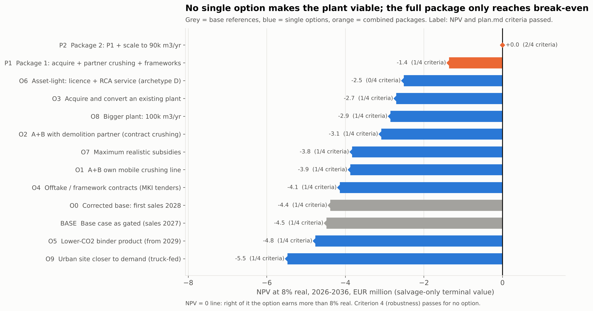

# Viability options — what would make the circular concrete business viable?

Agent 7 (Viability strategist). Date: 2026-10-22. **Re-run after the red-team critique** (`review/critique.md`; decisions in `review/response.md`, results in its section "Results after fixes"). All money is in **real 2026 €, excl. VAT**. NPV at **8% real**, 2026–2036, terminal value = salvage only (plan.md §2.1, not changed).
Model: `model/model_core.py` (option logic) + `model/options.py` (option definitions, asset-light model, robustness test, policy tests, P2 range) + `model/financial_model.xlsx` (live option selector `Inputs!I3`, sheets `Opt_Overview` and `Opt_AssetLight`). Results: `model/results_options.json`. Chart: `model/charts/options_npv.png`.
Sources: `research/sources_options.md` (OPT-xx). Assumptions: `research/assumptions_options.md` (A-OPT-xx) and the critique fixes A-FIX-xx in `research/assumptions.md`.

**What changed in this re-run.** The base case now has first sales in 2028, 9 m³ truck loads and a 1.5% public premium (M1–M3). On-site crushing now uses evidence-consistent deal terms: gate fee €1/t (not €5/t), steel yield 1% (not 3%) with the steel value split 50/50 with the partner, and a €3/t washing/screening cost for own RCA (H3, M5). The packages use the acquired-plant ramp 55/85/100% (H4), the exact delivery distance (22.7 km at 90k, 23.9 km at 100k; H5), and P2 carries +€1.0M expansion capex (M6). In O5 the MKI value is netted against the public premium (M7). The earlier "+€414 / break-even" result for P2 does not survive these fixes.

---

## 0. Summary

1. **No route is investable on present evidence.** We tested 10 single options and 2 packages in the financial model. Every one has a negative NPV, between −€2.5M (asset-light) and −€6.3M (see §2). None passes more than 1 of the 4 criteria, and none passes criterion 4 (0 of 6 drivers).
2. **The base case is now the realistic timing (first sales 2028).** NPV −€5.33M. The original base (sales 2027, 10 m³ loads, 3% public premium) is kept as memo case `O_orig`: −€4.48M. **Verdict for both: NOT VIABLE.**
3. **Only one lever moves NPV by more than €1M on its own, and it is about plant economics, not "green":**
   - **buy an existing plant instead of building one** (O3): −€3.54M, **+€1.79M vs the base**, with a lower funding need (€4.9M);
   - **more volume** (O8, 100k m³/yr): +€1.18M, but it needs ~3× an average Dutch plant's volume.
   
   On-site crushing no longer adds value on evidence-consistent terms: with a demolition partner (O2) −€0.09M vs base, with an own line (O1) −€0.91M. The green levers add little or lose money: a lower-CO₂ binder (O5) −€0.53M, extra subsidies (O7) +€0.56M, framework contracts (O4) +€0.19M.
4. **The packages do not beat the acquisition alone.** P1 (acquire + partner crushing + framework contracts) gives NPV **−€3.97M**; P2 (P1 at 90k m³/yr with a second framework contract and +€1.0M expansion capex) gives **−€4.01M**, IRR −10.6%, payback not reached. **P2 is a combination of favourable inputs** (90k m³ = 2.7× an average Dutch plant, frameworks, a long rubble contract). Reported as a range of stacked inputs it is **−€6.8M (downside) / −€4.0M (base) / −€1.4M (upside)**. Even the upside stack (gate fee €5/t, steel 3% kept 100%, 10 m³ loads, 3% public premium, washing €2/t, expansion capex €0.5M) stays below zero.
5. **What P2 would need:** a gate fee of **≈ €30/t** for NPV = 0 on its base terms (€26/t if 3% steel stays with us; €15/t if every other stacked input is at its upside). The bulk evidence is €0–1/t for clean concrete rubble (GWL, MKT-20) and ~€20/t only for small counter loads (MKT-23). So the gate fee and the steel split are **hard gates**, not targets, and today's evidence says they fail.
6. **Policy cannot rescue the stand-alone plant.** A primary-aggregate levy does not help at any level. A faster ETS phase-out hurts (−€0.2–0.3M). The public green premium needed for NPV = 0 is 58.5% (base) or 37% (P2), against 1.5% assumed.
7. **Recommended path (reframed, critique M10):** *"No route is investable on present evidence. The integrated acquisition route is the only one that comes close; it is worth a small (€50–100k) due-diligence phase to test gates A–C, not an investment."* On the fixed inputs the acquisition alone (O3) is as close as the integrated packages; integration helps only if gate B (gate fee and steel split) turns out far better than the evidence. Do not build a greenfield plant.

---

## 1. Method

- **Criteria** (plan.md §2.1, unchanged):
  1. NPV > 0;
  2. payback < 7 years;
  3. EBITDA > 0 in the 3rd operating year (2030 with first sales 2028; 2029 for `O_orig`);
  4. NPV > 0 with at least 2 of the 6 main drivers at their pessimistic value, one at a time.
- **Criterion 4 for options** is relative to each option:
  - If the option itself sets a driver (for example utilisation at 90k), that value is stressed by the same ratio as in the base test (for example ×50/70).
  - For options with on-site crushing, the "RCA price" driver is replaced by its A+B analogue, the **gate fee** (low = €0/t). plan.md names the gate fee as a main driver.
  - For the asset-light option (O6) the plant drivers do not apply. Its own 6 drivers are used instead.
- **Model logic** in `model_core.py` and the workbook (live formulas):
  - `first_sales_delay_yr` (now an input, base 1): permits stay in 2026; plant capex, start-up costs, grant and MIA fall in the build year; depreciation starts in the first operating year.
  - **On-site crushing block** (`opt_crusher_*`, using the `hybrid_*` inputs): rubble intake follows the ramp-up; the coarse yield replaces purchased RCA (credited at the delivered price, €24.5/t) and **pays €3/t washing/screening** (A-FIX-07); surplus coarse RCA is sold ex-works; gate fee, sand and **our share of the steel value** (A-FIX-06); costs: contaminant disposal, diesel, wear, contract crushing, staff, maintenance, BRL 2506 certification and extra site lease; own crusher capex, MIA, depreciation and salvage.
  - **Circular-only price and cost deltas** from a start year (for the binder option).
  - **Override order in packages (H4):** `merge()` applies dicts left to right and a later dict wins. Packages list `ACQ_RAMP` last, so the acquired-plant ramp (55/85/100% of the package's own target volume) is not replaced by the framework ramp (75/95%). Documented in `options.py`.
  - **O6 asset-light** is a separate small model (`options.run_asset_light`, live sheet `Opt_AssetLight`), unchanged.
- **Excel–Python check** (`model/check_report.md`): **ALL CASES MATCH** in 23 recalculated cases, incl. every plant option through the live selector, the memo case `O_orig`, and the P2 downside and upside stacks.

---

## 2. Option table

The KPIs come from `model/results_options.json`. Payback is counted from 2026. "Funding need" is the lowest point of cumulative free cash flow, before financing. Feasibility runs from 1 (hard) to 5 (easy).

| # | Option | NPV €M | IRR | Payback | EBITDA 3rd yr €M | Funding €M | Capex €M | Criteria passed | Crit. 4 | Feas. | Who must act |
|---|---|---|---|---|---|---|---|---|---|---|---|
| – | Memo `O_orig`: original base (sales 2027, 10 m³, 3% premium) | −4.48 | −7.1% | not reached | 0.53 (2029) | 6.84 | 5.50 | 1/4 | 0/6 | – | – |
| **O0** | **Base: first sales 2028 (= new base)** | **−5.33** | −13.9% | not reached | 0.32 (2030) | 7.09 | 5.50 | 1/4 | 0/6 | 5 | Founders |
| O1 | A+B own mobile crushing line | −6.24 | −12.3% | not reached | 0.49 (2030) | 9.05 | 7.50 | 1/4 | 0/6 | 3 | Founders, province (waste permit), demolition suppliers |
| O2 | A+B with demolition partner (contract crushing) | −5.42 | −12.9% | not reached | 0.39 (2030) | 7.50 | 5.90 | 1/4 | 0/6 | 3 | Demolition partner, province |
| O3 | Acquire and convert an existing plant | −3.54 | −14.4% | not reached | 0.33 (2030) | 4.93 | 3.70 | 1/4 | 0/6 | 3 | Founders, seller, bank |
| O4 | Offtake / framework contracts | −5.14 | −14.6% | not reached | 0.25 (2030) | 6.67 | 5.50 | 1/4 | 0/6 | 3 | Contractors, RWS, municipalities |
| O5 | Lower-CO₂ binder product (from 2029) | −5.86 | −16.4% | not reached | 0.25 (2030) | 7.41 | 5.65 | 1/4 | 0/6 | 2 | Binder supplier, certification body |
| O6 | Asset-light licence + RCA service (D) | −2.51 | n/a | not reached | −0.28 (2029) | 3.35 | 0.20 | 0/4 | 0/6 | 2 | Founders, licensee plants |
| O7 | Maximum realistic subsidies | −4.77 | −13.0% | not reached | 0.32 (2030) | 6.49 | 5.50 | 1/4 | 0/6 | 2 | RVO |
| O8 | Bigger plant 100k m³/yr | −4.15 | −7.3% | not reached | 0.70 (2030) | 7.10 | 5.50 | 1/4 | 0/6 | 2 | Founders, anchor customers |
| O9 | Urban site closer to demand | −6.32 | −19.8% | not reached | 0.14 (2030) | 7.64 | 5.50 | 1/4 | 0/6 | 3 | Founders, municipality |
| **P1** | **Acquire + partner crushing + frameworks** | **−3.97** | −15.7% | not reached | 0.32 (2030) | 5.42 | 4.10 | 1/4 | 0/6 | 3 | Founders, seller, demolition partner, contractors |
| **P2** | **P1 + scale to 90k m³/yr (+€1.0M expansion)** | **−4.01** (range −6.77 to −1.42) | −10.6% | not reached | 0.59 (2030) | 6.37 | 5.10 | 1/4 | 0/6 | 2 | As P1 + a second anchor customer |

Every option's verdict is **NOT VIABLE**, and none is BORDERLINE. Ranking by NPV: O6 > O3 > P1 > P2 > O8 > O_orig > O7 > O4 > O0 > O2 > O5 > O1 > O9. (O6 has the least negative NPV only because it invests almost nothing; its EBITDA never turns positive.) Among the plant routes the acquisition routes (O3, P1, P2) are the least bad.

---

## 3. Per-option detail

### O0 — Base: first sales 2028 (now the base case)
- **Change:** `first_sales_delay_yr = 1` [A-OPT-01, A-FIX-01]. Permits and engineering (€0.5M) in 2026. Plant capex (€5.0M), start-up costs, the grant and MIA in 2027. Ramp-up 50/79/100% in 2028/29/30. 9 operating years.
- **Result:** NPV −€5.33M. EBITDA +€0.32M in 2030. Funding need €7.09M. 1/4 criteria.
- **Timing alone is nearly neutral:** with the other new inputs, sales in 2027 would give −€5.57M, i.e. the year of delay is worth +€0.24M (the deferred capex is worth slightly more than the lost first-year margin). **Time is not the problem; the plant's margin is.** The fall from −€4.48M (original) to −€5.33M comes from the 9 m³ truck loads (−€0.77M) and the lower public premium (−€0.18M).

### O1 — A+B own mobile crushing line
- **Changes:** base + `opt_crusher_on = 1`; crushing from 2029 (waste permit about 18 months) [A-OPT-02]; intake 40.5 kt/yr (sized to own RCA need); capex €2.0M (mobile crusher €1.6M, A-TEC-40, + site works €0.4M, A-OPT-03), 100% MIA-eligible, 10% salvage [A-OPT-04]; 3 crushing FTE, diesel 0.3 l/t, wear €0.4/t, maintenance 3%, BRL 2506 €25k/yr, extra 1 ha leased; **gate fee €1/t** (A-MKT-15, A-FIX-04), yields 58/38/**1**/1% (A-TEC-01–04, A-FIX-05), sand €3/t, steel €150/t kept 100% (no partner), **washing/screening €3/t of coarse RCA** (A-FIX-07).
- **Crushing line at full output (2031):** net result about **+€0.17M/yr** (was +€0.52M). Own RCA replaces purchases worth €0.58M; gate fee €0.04M, steel €0.06M, sand €0.05M. Costs: staff €0.22M, extra lease €0.10M, washing €0.07M, maintenance €0.06M, contaminants €0.05M, certification €0.03M, diesel and wear €0.04M.
- **Result:** NPV −€6.24M (−€0.91M vs base). EBITDA 2030 €0.49M. Funding need €9.05M (the highest).
- **Ranges:** gate fee €0 / €10 per t → −€6.43M / −€4.60M; steel yield 0.5% / 3% → −€6.38M / −€5.68M; washing €4 / €2 per t → −€6.35M / −€6.13M; crusher capex +45% / −30% → −€7.10M / −€5.67M.
- **Risks:** the waste permit (9–36 months, A-POL-20); rubble supply (demolition firms build their own high-grade lines, competitors.md §11); 3 FTE are heavy for 40 kt; sand outlet almost nil (€3/t).
- **Feasibility 3.** Not recommended.

### O2 — A+B with a demolition partner (contract crushing on our site)
- **Changes:** as O1, but the partner crushes in campaigns at **€7.5/t** (machine, operator, diesel and wear included) [A-OPT-05; OPT-04 is a single UK contractor page that could not be re-verified (HTTP 503) — **unverified anchor**, no Dutch tariff found]; our capex is only €0.4M of site works; 1 FTE; gate fee €1/t and a **50/50 steel-value split** fixed in the supply contract (A-FIX-04/06).
- **Crushing line at full output:** net result ≈ **+€0.06M/yr** (was +€0.45M). Revenue and avoided cost: RCA credit €0.58M, sand €0.05M, gate fee €0.04M, steel €0.03M. Costs: contract crushing €0.30M, extra site lease €0.10M, washing €0.07M, staff €0.07M, contaminants €0.05M, certification €0.03M, maintenance €0.01M.
- **Result:** NPV −€5.42M (−€0.09M vs base). Funding need €7.50M.
- **Ranges:** gate fee €0 / €10 per t → −€5.60M / −€3.89M; contract rate €10 / €5 per t → −€5.90M / −€4.93M; steel yield 0.5% / 3% → −€5.49M / −€5.14M; steel share 0% / 100% → −€5.56M / −€5.28M; washing €4 / €2 → −€5.53M / −€5.30M.
- **Why the line no longer pays:** the earlier result relied on a €5/t gate fee and 3% steel kept by us (together ~€9.5/t of value). The research's own bulk source (GWL, MKT-20) accepts clean concrete rubble at **€0/t** and charges the deliverer **+€3.5/t** for reinforced rubble, so steel removal is a cost the crusher charges for, not a windfall (critique H3).
- **Feasibility 3.** Who must act: a demolition firm (examples in competitors.md §12) and the province (permit).

### O3 — Acquire and convert an existing ready-mix plant
- **Changes:** purchase price **€2.5M** (€1.5–4.0M) [A-OPT-06] + conversion €0.8M [A-OPT-07] → `capex_plant_equipment` 3.3; civil €0.2M; permit change and transaction €0.2M; pre-opening €100k; ramp-up 55/85/100% [A-OPT-08]; maintenance 3.5% [A-OPT-09]; salvage 15% [A-OPT-10]. Purchase and conversion in 2027, **first sales under our name 2028** (the purchase gates close in Q2 2027).
- **Result:** NPV −€3.54M (+€1.79M vs base). Capex €3.7M. **Funding need €4.93M (−€2.2M vs base).**
- **Ranges:** purchase price €4.0M / €1.5M → −€5.21M / −€2.48M; greenfield-like ramp vs a fast one → −€3.69M / −€3.33M; truck-fed site (gravel +€5/t) → −€5.13M.
- **NPV = 0 alone** would need about 113k m³/yr.
- **What €2.5M buys (critique M6):** the price is an ESTIMATE based on an average Dutch plant of ~34k m³/yr (ERMCO 2023, CMP-43) at an EBITDA of €6–8/m³. So **€2.5M buys a ~35k m³ plant with its customer book**. Reaching 70–90k m³ needs extra customers (frameworks) and, at 90k, extra capacity (modelled as +€1.0M in P2).
- **Margin evidence:** the OPT-01 figures (Cementir ≈ €18M for one Danish plant + a minority stake; ready-mix segment EBITDA €38.9M) and the OPT-02 8% ready-mix margin come from search excerpts that the red team could **not confirm** — treat them as **unverified**. A further data point from the critique: **4K-Beton (18 plants, 0.6 Mm³/yr) EBITDA €2.9M on €50.7M revenue = 5.7%** (Cemnet, cited by the red team; not opened by us) — consistent with thin ready-mix margins and with our base-case plant margin of 2–3%.
- **Why it still makes sense to look at:** ~178 plants for 6.0 Mm³ with spare capacity (CMP-43); groups are exiting or consolidating (CMP-33, CMP-38); buying adds **no new capacity**; it removes the build year.
- **Risks:** older equipment; the site may not be waterside or may lack space; customers may leave after the change of owner; no Dutch transaction prices found (data gap).
- **Feasibility 3.** Who must act: the founders, a seller and the bank.

### O4 — Offtake / framework contracts (MKI-based tenders)
- **Change:** base + ramp-up 75/95/100% [A-OPT-11] at a framework discount of −€1.0/m³ on all volume [A-OPT-12].
- **Result:** NPV −€5.14M (+€0.19M vs base). Discount −€2 / €0 → −€5.51M / −€4.76M.
- **Why so small:** a faster ramp-up only brings forward the margin of 2 years of volume, and that margin is thin. Contracts mainly **reduce volume risk**. They are a precondition for the packages, not a lever on their own.
- **Feasibility 3.**

### O5 — A genuinely lower-CO₂ binder (from 2029)
- **Product:** a circular mix with a binder ~30% lower in CO₂ than CEM III/B (everox activated cement paste, TRL 6–7; or an Ecocem ACT-type cement, company claims OPT-05/06).
- **Changes:** from 2029, **+€0.69/m³** price on circular volume = the MKI value of €1.5 [A-OPT-13] **minus the public premium already in the base** (40% × 1.5% × €135 = €0.81 per circular m³), so the MKI value is not counted twice (critique M7, A-FIX-11); +€1.5/m³ cost on circular volume [A-OPT-14]; €150k certification/EPD one-off + €40k/yr [A-OPT-15].
- **Result:** NPV −€5.86M (−€0.53M vs base). MKI value 0 & cost +€4 / MKI value €4.5 & cost 0 → −€6.50M / −€4.83M.
- **Why it earns so little:** −40 kg CO₂/m³ is worth ≈ €5 MKI/m³; the fictive advantage reaches only MKI tenders (≈20% of our volume) and the supplier keeps ~30% of it. To reach NPV = 0 on the base, the captured value would need to be **€32 per circular m³** (€20 on P2).
- **Strategic value:** a **hedge** against CEM III/B slag scarcity (A-POL-28) and a real CO₂ story. **Not a profit driver.**
- **Feasibility 2.**

### O6 — Asset-light: licence + RCA service (archetype D platform)
- Unchanged by the critique fixes (separate model, no plant; sales from 2027 because no build is needed).
- **Revenue:** fee **€2/m³** [A-OPT-20]; RCA brokerage €1.5/t [A-OPT-21]; LCA services €100k/yr [A-OPT-22]. **Licensees:** 4 at maturity, +1 per year, 15k circular m³ each [A-OPT-19]. **Costs:** 4 FTE, €150k overhead, €350k start-up, €200k capex [A-OPT-23].
- **Result:** NPV −€2.51M. EBITDA stays negative (−€0.28M in 2029). Funding need €3.35M. **0/4 criteria.** EBITDA breaks even only at ≈ 10 licensee plants, not reachable by 2036.
- **Use:** a capped-downside **fallback** or a later add-on. **Feasibility 2.**

### O7 — Maximum realistic subsidies
- **Change:** base + DEI+ grant €1.0M (instead of €0.4M) + 50% of plant capex MIA-eligible [A-OPT-16].
- **Result:** NPV −€4.77M (+€0.56M vs base). On P2 these subsidies give −€3.50M. VEKI does not fit (our circular mix avoids ~0 CO₂ vs CEM III/B); the EU Innovation Fund is for large binder projects.
- **Feasibility 2.**

### O8 — Bigger plant: 100k m³/yr
- **Change:** base + 100k m³/yr, +2 production FTE, average delivery **23.9 km** (= 20 km × √(100/70), not rounded; critique H5) [A-OPT-17].
- **Result:** NPV −€4.15M (+€1.18M vs base). NPV = 0 needs **~159k m³/yr**.
- **Market check:** 100k m³ = the SOM high case, ≈ 3× an average Dutch plant (33.7k m³, ERMCO 2023) and ≈ 12% of all ready-mix in the radius (0.84 Mm³, market.md §8). **Feasibility 2.**

### O9 — Urban site closer to demand (truck-fed)
- **Change:** base + delivery 15 km, lease €15/m², gravel by truck +€5/t [A-OPT-18].
- **Result:** NPV −€6.32M (−€0.99M). Stay **waterside**.

### C — Element reuse add-on (screening only, not modelled)
- No public prices or volumes. Not a viability lever for this case.

---

## 4. Packages

### P1 — Acquire + partner crushing + framework contracts
- **Changes:** O3 (acquisition) + O2 (partner crushing from 2029, +€0.4M site works) + O4 framework discount (−€1/m³). Ramp = **acquired-plant ramp 55/85/100%** (H4: listed last in the merge, so it wins). First sales 2028.
- **Result:** NPV **−€3.97M**, IRR −15.7%, payback not reached. EBITDA 2030 €0.32M. Funding need €5.42M. Capex €4.10M. 1/4 criteria.
- **Ranges:** gate fee €0 / €10 per t → −€4.16M / −€2.55M; purchase price €4.0M / €1.5M → −€5.65M / −€2.87M; greenfield ramp 50/79 / framework ramp 75/95 → −€4.13M / −€3.55M.
- **NPV = 0 needs any one of:** a gate fee of **€28.3/t**; **120k m³/yr**; an average price of **€149.2/m³** (+10.5%). Even a free plant does not reach NPV = 0 on its own.

### P2 — P1 + scale to 90k m³/yr (a combination of favourable inputs)
- **What P2 is, said plainly (critique H5):** it combines the "high" utilisation input (90k m³ = 2.7× an average Dutch plant, ≈ 11% of all ready-mix in the radius, from an acquired plant), two framework contracts and a long rubble contract. It is a scenario of favourable inputs, not a likely case.
- **Changes vs P1:** 90k m³/yr, +1 production FTE, average delivery **22.7 km** (20 × √(90/70), not rounded), **+€1.0M expansion capex** [ASSUMPTION, A-FIX-10, range €0.5–2.0M], acquired-plant ramp 55/85/100% **of 90k** (49.5k / 76.5k / 90k m³ in 2028/29/30).
- **Result (base terms):** NPV **−€4.01M**, IRR −10.6%, payback not reached. EBITDA 2028 −€0.34M; 2029 +€0.27M; 2030 +€0.59M; 2036 €0.41M. Funding need €6.37M. Capex €5.10M. **1/4 criteria, 0/6 on criterion 4. NOT VIABLE.**
- **Why the earlier "+€414" is gone** (step by step from the old P2 definition, each step cumulative):

| Step | NPV €M | Change |
|---|---|---|
| Old P2 (sales 2027, gate fee €5, steel 3% kept, 22 km, framework ramp 75/95, 10 m³, 3% premium) | +0.00 | |
| First sales 2028 | −0.24 | −0.25 |
| 9 m³ truck loads | −1.07 | −0.83 |
| Public premium 1.5% | −1.25 | −0.18 |
| Gate fee €1/t | −1.81 | −0.56 |
| Steel yield 1% | −2.23 | −0.42 |
| Steel value split 50/50 | −2.34 | −0.11 |
| RCA washing/screening €3/t | −2.60 | −0.26 |
| Acquired-plant ramp 55/85 of 90k | −3.00 | −0.40 |
| Exact distance 22.7 km | −3.13 | −0.14 |
| Expansion capex +€1.0M | **−4.01** | −0.88 |

- **P2 as a range (stacked inputs, critique H2):**

| Stack | Inputs changed vs P2 base | NPV €M | IRR | Payback | Funding €M |
|---|---|---|---|---|---|
| Downside | gate fee €0, steel 0.5%, washing €4/t, expansion €2.0M, public premium 0%, 8 m³ loads | **−6.77** | −25.9% | not reached | 7.91 |
| Base | – | **−4.01** | −10.6% | not reached | 6.37 |
| Upside | gate fee €5, steel 3% kept 100%, washing €2/t, expansion €0.5M, public premium 3%, 10 m³ loads | **−1.42** | 1.9% | 9.9 yr | 5.49 |

  These are stress stacks, not probabilities. Timing (2028), the acquired ramp and the exact distance stay fixed in all three.
- **Gate fee needed for NPV = 0:** **€29.7/t** on P2 base terms; €25.9/t with 3% steel kept 100%; €15.2/t with every other stacked input at its upside; €45.3/t at the downside. The upside stack with a €10/t gate fee is still −€0.72M.
- **One-at-a-time ranges:** gate fee €0 / €10 → −€4.16M / −€2.74M; steel 0.5% / 3% → −€4.07M / −€3.79M; steel share 0% / 100% → −€4.13M / −€3.90M; washing €4 / €2 → −€4.10M / −€3.92M; expansion capex €2.0M / €0.5M → −€4.90M / −€3.57M; purchase price €4.0M / €1.5M → −€5.58M / −€3.01M; volume 75k / 100k → −€5.37M / −€3.29M; discount rate 6% / 10% → −€3.90M / −€4.10M; no grant −€4.33M; sand €0 −€4.19M; framework ramp 75/95 instead of 55/85 −€3.61M.
- **Add-ons:** P2 + O7 subsidies −€3.50M; P2 + O5 binder −€4.51M; P2 + 100% concrete price pass-through −€3.63M.

---

## 5. Robustness test (criterion 4) on the best options

NPV in €M when one main driver is set to its pessimistic value (option-relative, see §1):

| Driver (pessimistic) | O0 (base) | O2 | O3 | P1 | P2 |
|---|---|---|---|---|---|
| Green premium 0% public / −2% private | −5.86 | −5.95 | −4.08 | −4.51 | −4.59 |
| RCA price €25/t (O0, O3) / gate fee €0/t (O2, P1, P2) | −6.54 | −5.60 | −4.77 | −4.16 | −4.16 |
| Transport distance (delivery ×1.75, RCA haul 50 km) | −8.96 | −8.49 | −7.23 | −7.10 | −8.62 |
| Cement €130/t + high ETS/CBAM path | −7.93 | −8.02 | −6.18 | −6.62 | −7.30 |
| Utilisation ×50/70 | −7.51 | −7.91 | −5.76 | −6.41 | −6.52 |
| Capex ×1.45 (incl. purchase price and crushing works) | −7.86 | −8.09 | −5.18 | −5.76 | −5.69 |
| **Drivers with NPV > 0** | **0/6** | **0/6** | **0/6** | **0/6** | **0/6** |

The asset-light option (O6) is 0/6 on its own drivers too. **No option is robust.** The two most dangerous drivers stay **transport distance** (delivery is ~15% of price) and **cement/ETS**.

---

## 6. What the business depends on (policy and market)

The policy tests come from `options.policy_tests`. The levy is applied to all producers, and 80% of the standard mix's extra cost is passed into concrete prices.

| Change | O0 (base) | P1 | P2 |
|---|---|---|---|
| Primary aggregate levy (gravel + sand) | **no level gives NPV = 0**; €5/t → −€5.37M | no level; €5/t → −€4.02M | no level; €5/t → −€4.07M |
| Public green premium needed for NPV = 0 (base 1.5%) | 58.5% | 44% | 37% |
| MKI value per circular m³ needed for NPV = 0 (estimate with a low-CO₂ binder: €1.5 gross) | €31.8 | €23.8 | €19.5 |
| High ETS/CBAM path ("faster phase-out of free allocation") | −€5.60M | −€4.24M | −€4.30M |
| Landfill tax €81/t (2030), via contaminant disposal | no effect (no crushing) | −€0.08M vs P1 | −€0.06M vs P2 |
| Gate fee €10/t (top of the new range) | n/a | −€2.55M | −€2.74M |
| Gate fee for NPV = 0 | n/a | €28.3/t | €29.7/t |
| Average concrete price for NPV = 0 (today €135/m³) | €154.0 | €149.2 | €146.7 |
| Steady volume for NPV = 0 | 134k m³ | 120k m³ | 147k m³ |

**Reading the table:**
1. **A levy on primary aggregates does not help this business model**: our mixes still use 1.25–1.9 t of primary sand and gravel per m³, so the levy raises our cost about as much as the market price.
2. **A faster ETS phase-out hurts**: we buy CEM III/B like our competitors, and the market passes on only 80% (a key judgement call; at 100% the base improves by €0.4M).
3. **The market changes that would matter:** (a) much higher gate fees for clean rubble (€15–30/t needed, against €0–1/t today); (b) MKI ceilings at front-runner level, worth something only with a lower-CO₂ binder; (c) plant prices staying low. None is in sight on present evidence.
4. **None of the needed conditions is a "green" factor.** The circular content can open deals (partner, tenders), but it does not pay for itself.

---

## 7. Recommended path

1. **No route is investable on present evidence.** Stop the greenfield plan (base): it cannot reach NPV = 0 with any realistic single change.
2. **The integrated acquisition route is the only one that comes close.** It is worth a small **due-diligence phase of €50–100k** to test three gates, **not an investment**. On today's evidence the acquisition alone (O3, −€3.5M) is as close as the integrated packages; integration helps only if gate B is far better than the evidence.
   - **Gate A — plant:** a waterside ready-mix plant in Zuid-Holland at **≤ €2.5M** (≈ a 35k m³ plant), with 1 ha of space and a permit route for rubble acceptance; an expansion quote for 90k m³ (modelled at €1.0M).
   - **Gate B — rubble (hard gate):** a 7–10-year contract with a demolition firm that gives a **gate fee in the range needed for NPV = 0 (≈ €15–30/t, depending on the other inputs)** and a written **steel-scrap split**. Today's evidence (€0–1/t bulk, reinforced rubble charged extra) says this gate fails. If it fails, the crushing part adds nothing and P1/P2 collapse to O3.
   - **Gate C — volume:** framework or offtake contracts for **≥ 40k m³/yr** with GWW contractors or public clients, signed before any purchase.
   
   If any gate fails, do not invest. The fallback is the asset-light service (O6) as a small pilot only (capex €0.2M, expected losses ~€0.3M/yr).
3. **O5 (lower-CO₂ binder)** only as a research hedge (trials funded with WBSO/DEI+), not as a profit line.
4. **For the jury:**
   - "The stand-alone circular plant is not viable."
   - "No route is investable on present evidence; the integrated acquisition route comes closest."
   - "Even its favourable-input stack (P2 upside, −€1.4M) stays below zero; break-even would need a gate fee of €15–30/t against €0–1/t in the market."
   - "We propose a €50–100k diligence phase to test the three gates, not an investment."
   
   Show the P2 range and criterion 4 failing openly.

---

## 8. Data gaps (what would change the conclusion fastest)

1. **Dutch gate fees for clean concrete rubble (bulk, multi-year)** and the steel content / steel ownership in such contracts. Gate fee €0 → €10/t is worth €1.4M on P2.
2. **Prices paid for small Dutch ready-mix plants** (asset deals 2022–2026) and the cost of expanding one to 90k m³. Purchase price €1.5–4.0M is worth €2.6M on P2.
3. **Real project prices** by strength class (the #1 driver; the base €135/m³ is likely at or above the market average).
4. **Contract-crushing and washing rates in NL** (only an unverified UK price was found).
5. **ACP / ACT binder price and certification date**; **GWW decree ceiling levels (2028)**.
